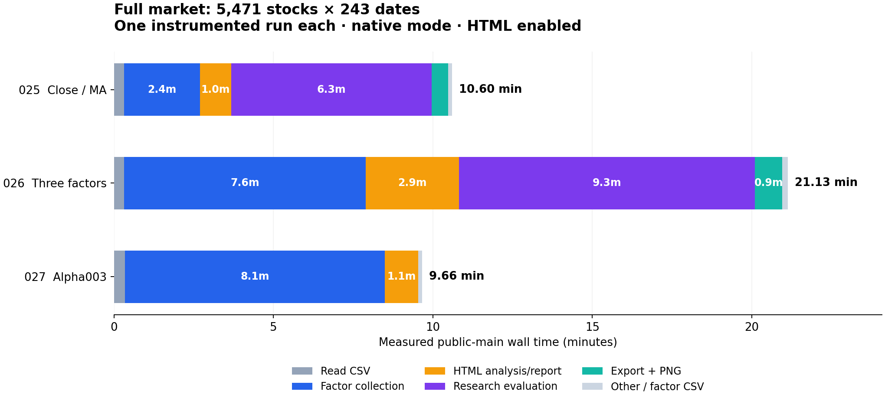
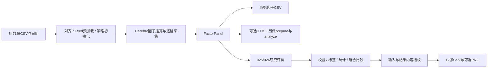

# 迭代49：全市场因子分析性能优化

日期：2026-10-23。本轮承接迭代45–48以及已完成的[单类双模式重构](../迭代49-因子单类双模式重构/实施与验收.md)，单独记录全市场性能诊断，不改写历史验收。本轮任务是实际运行025、026、027的全部股票，找到时间去向，并形成下一轮优化方案；不是提前宣称优化已实现。

**计划修订（2026-10-23）：** 本地fincore已更新到`e04bd082`，与本次全量使用的归档版本相同，130个包内Python文件逐字节一致。后续直接使用本地dev。具体改法、逐项收益预算、条件推进项和验收门槛以[《实施方案与500股验收》](实施方案与500股验收.md)为准：**开发只用固定500股票×243日期，全部优化完成后才再次测5471全量**。固定样本见[benchmark-500.json](benchmark-500.json)。本页保留首轮实际测量事实，不把预算写成已实现收益。

**结论：全5471股票已经跑完。025/026首先优化研究评价，027首先优化采集和引擎中的重复结构检查；CSV读取不是当前主瓶颈。** 不需要人读报告时，可以直接省略HTML；需要改代码的首批工作是目标资产查找、不可变日历摘要缓存和内容指纹流式化。核心时钟、算子读取与并行放在保持结果等价的后续轮次。

## 测量范围与版本

- 输入：仓库公开 `tests/datas/a_stocks`，manifest全部 **5,471** 个标的、**243** 个源观测日，2025-01-02至2025-12-31。输出完整网格为 **1,329,453** 个股票日；缺行、窗口不足与非有限值保持原有NaN语义，不向前填充。
- 三例均调用原 `run.py` 的公开 `main(argv)`，传入 `--max-symbols 0 --factor-mode native --report` 和独立新输出目录。025/026保持默认runonce、完整研究评价及默认PNG；027保持默认runnext和单因子HTML报告。没有切换到027的分块验收入口，没有缩小日期或股票范围。
- Backtrader代码基线：dev `dd33dd1d162652cf1d1a5e5cd0ed9b3fb05f815b`。保留原工作区无关变动，未创建开发worktree，未修改因子计算代码和示例默认500配置。
- fincore：首轮实际使用固定远端dev快照 `e04bd082b85374d58e304ec15d43dd134b7fe77b`。测量时本机原dev `d7f65460c4f885e979d8543ddb15cc8f3c892742` 没有兼容报告接口，能力检查也缺turnover结果表；其20资产预检只产生PANEL_ONLY，不能算完整流程通过。当时保留原dev，使用git archive解包快照，不修改全局Python安装。用户随后已将本地dev更新至相同e04bd082；“依赖待恢复”不再是后续阻塞。
- 历史验收使用的fincore `4b8f31b1b59707480d5db9603704d83bbf7e6946` 在测量时本机没有对象，按该SHA向远端获取也返回not our ref。因此这里是**当前可取得依赖下的本机诊断**，不是历史固定wheel验收的性能复现；后续以已统一的e04bd082源码为起点做500股票配对比较。
- 环境：Windows，Intel Core i9-13900HX，24核/32逻辑处理器，约31.7 GiB物理内存；Anaconda CPython 3.11.5、pandas 2.2.3、NumPy 1.26.4。三例串行运行；运行时其他应用仍占内存，不是专用空闲基准机。

## 计时口径

测量脚本为 [`scripts/profile_factor_examples.py`](../../../../../scripts/profile_factor_examples.py)。它保留原函数行为，在阶段边界加计时，并由线程约每100ms采样一次主线程Python调用栈、每秒记录RSS与进程CPU。写盘的栈分类使用前8帧前缀，保留最高频80类；叶帧和最近项目帧分别保留最高频60类。没有使用高开销的逐函数cProfile，也没有替换数学实现。

`wall_seconds` 包含公开main中的读取、对齐、引擎、采集、CSV、报告、评价与导出，但不包含预导入、计时前后源码/数据哈希、独立结果回读和进程退出。前置输入哈希会预热操作系统文件缓存，因此读取时间不是冷盘测速。它是**单次带观测的main墙钟**，不是冷启动CLI、无扰动测速或多轮统计性能验收。Windows峰值工作集覆盖整个测量进程；采样比例只能用于定位，不能当成精确函数CPU秒数。

计时是嵌套的，`collection_total`包括align和Cerebro，Cerebro又包括引擎和采集；不能把inclusive值相加。exclusive是减去已覆盖子阶段后的墙钟余量，仍可含未单独计时的工作。`FactorStrategy.__init__`经框架保存的`_original_init`执行，因此构造没有独立timer事件，相关工作落在Cerebro余量中；这不表示没有初始化。

运行前后逐个校验全部输入CSV、manifest、日历、Backtrader/fincore Python源码、示例公开配置和测量脚本的SHA-256。该校验在测速边界外。另行回读输出才能确认没有出现runner吞掉报告错误、只生成部分产物的情况。

## 实测结果

原始证据保存在 `D:/temp/iteration49-full-025-20261023`、`026`、`027` 对应目录。下表各主阶段互斥，单位为秒；采集包含对齐、预加载、初始化、因子运行、逐格收集和面板收尾。

| 阶段 | 025 Close/MA | 026 三因子 | 027 Alpha003 |
|---|---:|---:|---:|
| 读取CSV/面板 | 18.963 | 19.468 | 20.771 |
| 采集总计 | 142.632 | 453.977 | 488.821 |
| HTML分析与报告 | 59.272 | 175.880 | 63.041 |
| 研究评价 | 376.860 | 556.838 | 不适用 |
| 评价导出（含PNG） | 31.370 | 51.528 | 不适用 |
| 其余（含因子CSV） | 6.834 | 9.845 | 7.216 |
| **main墙钟总计** | **635.932** | **1267.536** | **579.849** |
| 约合时长 | 10分36秒 | 21分08秒 | 9分40秒 |
| 进程CPU秒 | 618.547 | 1222.016 | 560.000 |
| 进程峰值工作集GiB | 6.972 | 8.347 | 2.817 |



三例summary均为COMPLETED、5471标的/243日期、native实际运行、submit/cancel均为0，Python退出0；025/026评价OK，027原有quick流程没有研究评价阶段。每次运行的6213个公开源码/输入文件在前后校验中均未变化。三例共约41分23秒main墙钟；预检、哈希和回读时间未计入。

025采集内部：align 25.719s；feed preload 20.025s；Cerebro未细分部分20.477s；runonce 73.153s，其中逐格收集18.402s；stop 3.026s，其中sink finalize 2.786s。完整评价占总时间59.3%，不应只围绕因子公式做优化。

026采集内部：align 26.658s；feed preload 21.027s；Cerebro未细分部分163.349s；runonce 239.382s，其中逐格收集34.415s；stop 3.290s，其中sink finalize 3.062s。其评价占43.9%、采集占35.8%、三个报告占13.9%。025/026中采集最终物化都仅约3秒，不应先重写sink作为主攻方向。

027采集内部：align 28.766s；feed preload 21.470s；Cerebro未细分部分111.242s；runnext 323.428s，其中逐格收集21.831s；stop 3.059s，其中sink finalize 2.839s。采集占总时间84.3%，HTML占10.9%。它和025/026的流程范围不同，不能只比较总时间就推断哪个因子或引擎模式更快。

两例CPU/墙钟分别约0.97和0.96，平均接近占用一个CPU核，不是32逻辑核充分并行。系统可用内存的一秒采样最低分别约110 MiB和172 MiB；机器处于实际内存压力下，不能把这里的数据声称为空闲专用机器的基准，后续配对应固定背景负载。也不能据CPU核数直接开32个进程。

027 CPU/墙钟约0.97，系统可用内存采样最低约6.81 GiB；它没有经历025/026同等程度的内存压力。CSV读取仅占三例总时间的3.0%、1.5%、3.6%，优先把CSV迁到数据库不是本次最有证据支持的方向。

## 结果回读

独立只读回读通过，见[完整回读记录](measurements/readback.json)。三份因子CSV均有1,329,453行、5471资产、243日期，无重复key、未知资产、缺失网格或无穷值。NaN保留，不能为提速填0或删掉行。

| 因子 | 有限值个数 | NaN个数 |
|---|---:|---:|
| 025 Close/MA | 1,196,833 | 132,620 |
| 026 Close/MA | 1,196,833 | 132,620 |
| 026 KDJ J | 1,238,146 | 91,307 |
| 026 ROC | 1,190,950 | 138,503 |
| 027 Alpha003 | 1,255,737 | 73,716 |

025/026共同的Close/MA按每个(time, asset)精确float64比较，1,196,833个有限值及132,620对NaN全部一致，差异为0。五份HTML均非空；025/026各自12张评价CSV、2张PNG及manifest齐全，CSV行数与manifest一致。回读检查的是结构、输出完整性和共同因子一致性，不是重新实现数学oracle，也不是新增实盘验收。

026的diagnostics保留7条info：1条组合构建，以及6对因子的相关性各跳过19或20个资产数不足的日期。评价仍报告OK；这些初始窗口覆盖说明不能为追求速度而删掉或伪装成全日期可评价。

大文件主要是明细：025评价signals约149.5 MB、labels约235.0 MB；026分别约440.6 MB、235.0 MB。三例输出目录含测量记录合计约1.33 GB（十进制）。HTML只有约1.1 MB/份，生成慢主要不是写HTML文件；选择不导出长表可省I/O和空间，但要连同构造/指纹工作一起按需求分级，才能减少更大的计算成本。

## 已有实测支持的热点

### 1. 评价的资产存在性检查重复扫描长索引

fincore e04bd08 `factor_analysis/research.py:760–786` 的 `_validate_factors` 创建含所有股票日的asset Index，然后逐一检查每个target是否存在：`[target for target in spec.targets if target not in assets]`。这个Index有133万项且资产重复；当前pandas路径中反复进入`Index.__contains__`和`numpy.where`。

025的4861个总样本中，**1065个（21.9%）**最近项目帧落在该listcomp；其中857个叶帧为pandas contains，207个为NumPy where。这是本次运行捕获的调用栈，不只是复杂度猜测。建议只为存在性检查一次建立 `assets.unique()`，再保持原targets顺序生成missing列表，原assets仍用于面板构建。不要用可能含未使用元素的 `MultiIndex.levels`，也不要未经混型/NA等值验证直接改成Python set。不能删除缺标的检查、把重复(time, asset)视为合法，或更改返回面板排序。预期收益需实现后的配对实验确认，不能用采样占比直接换算为承诺节省秒数。

### 2. 内容指纹逐标量编码和巨大临时字节串

评价末尾的 `research.py:1966–1993` 对输入及全部结果表做指纹。`models.py:1149–1179,1202–1329` 将列转为object/list/tuple，再递归编码并拼接。这不是SHA-256算法本身慢，而是其前面的Python对象遍历、类型判断、序列化和临时内存成本。

025最近项目帧采样点数为 `_fingerprint_bytes` 1279、`_fingerprint_envelope` 617、`_fingerprint_pandas` 83，仅这三个互斥分类合计1979/4861（40.7%）。这些是采样点，不是调用次数。完整进程峰值约6.97 GiB，显著高于采集完成约1 GiB；不能把瞬时RSS当成峰值。

建议先采用保持旧字节编码的分块/流式哈希，避免一次拼出完整嵌套bytes；若更换为dtype/shape/缺失掩码/连续buffer的规范编码，必须显式升级指纹版本，不能让旧ID悄悄换义。保留列/索引顺序、时区、dtype、NaN及类型区分的合同。不要简单去掉来源和结果指纹。

026的9829个总样本中，目标资产检查有1060个采样点；上述三个指纹函数合计3661个（37.2%）。指纹热点在三因子全量运行中同样出现。这里统计的是最近项目帧的互斥命中，覆盖完整流程中的相关函数，不是精确切分到某一个父阶段的CPU秒数或调用计数。

### 3. 同一不可变日历的哈希在每个feed重复生成

Backtrader `research/specs.py:574–580` 的 `grid_sha256` 每次遍历243个时间点、isoformat、JSON编码并hash。`align.py:145,161` 对每个feed读取两次；5471个feed共有10942次请求，输入日历相同。025的align计时25.719s，最近项目帧中该property及其listcomp共158个样本，align粗阶段共233个样本；采样支持先解决重复日历工作。

建议在ResearchSpec构建时对其私有、已规范化的grid计算一次摘要并缓存，公开grid继续返回副本；全局跨不同spec缓存不必要。验收需保证返回哈希逐字节相同、时区/开闭时间改变会改变哈希、外部修改grid副本不会污染spec。

### 4. 026的时钟归属扫描和引擎推进

026的Cerebro未细分余量为163.349s，025为20.477s；该余量不是精确初始化计时，但026最近项目帧采样中 `_periodset` 本体有334个点，其 `strategy.py:939` 的line身份查找generator有467个点，`lineseries.__iter__` 在该启动栈下有242个点。源码 `strategy.py:925–946` 为MinimalClock的指标逐个扫描全部feeds及其lines找归属；`dataids`另有list membership。它们是实际命中的启动路径，值得单列优化。

`strategy.py:826–837` 已建立 `_line_to_feed`，建议优先复用或调整现有映射，并把 `dataids` 的成员检查改为ID集合。现有dict覆盖保留最后一个feed，而MinimalClock扫描取第一个匹配feed；不能直接替换，需保留首匹配语义，例如单独构造first-owner映射。保留fallback、owner/secondary clock/minperiod规则，不用对象的 `==` 代替 `is`，也不能通过改钟让缺失bar或多周期行为变化。此项触及核心多数据时钟，需相应全策略回归，优先级低于不碰核心时钟的查询与摘要缓存修复。

runonce内部还命中 `_tick_fill/_tick_nullify`、feed/indicator advance、line长度和逐格取值。025/026引擎余量（扣除已计时collect）分别54.751s/204.967s，不能全部叫“公式计算”。可进一步评估批量推进、只在确有tick语义时做必要工作、减少重复属性和时间转换，但应留在既有Cerebro生命周期内，不新增另一个调度器。注册去重虽有静态二次方风险，本次命中远少于上述热点，不能抢先做大范围改造。

### 5. 027的来源关系查询、窗口读取与节点调度

027共有4461个栈样本，启动路径再次出现：`_periodset`最近项目帧262个、line939生成器296个、该启动栈中的`lineseries.__iter__`159个。它也能受益于上一节的等价身份查找优化。

运行阶段突出的rank输入读取路径按前8帧栈前缀分成四个互斥类别，合计584个采样点：其中527个处于 `_active_values → _read_panel_value → _line_target_relation`（206个落在外层`__getattr__`、167个在内层`__getattr__`、154个在关系函数），另57个在读面板函数本身。采样显示动态属性与来源关系解析是实在成本，不能把所有runnext时间都归给相关系数数学运算。`_read_value/_read_window`在滚动相关路径分别有127/72个栈前缀样本，另有 `_factor_run_callback`、strict context和逐节点推进成本。

当前配置为单组：Alpha003只构造open、volume两个整面板rank节点，再为每资产构造RollingCorrelation和Multiply节点；**不是每个股票都再算一次全市场排名**。每个rank节点每期扫描和排序全体有效资产，两个输入向量不同。不能按股票分批独立排名，也不能跨日期缓存rank值。

下一步应验证能否在绑定时解析并持有不可变的source/target/clock关系，减少每格深层`getattr`和递归；直接算子API或可变绑定仍保留原检查或明确失效机制。当前grid索引、成员资格、数组边界、缺失原因和逐期值必须实时读取。预先构造已验证字符串group的分区是次一级候选（`_static_group_keys`最近帧36个点），不应盖过上述来源查询热点。滚动窗口可探索按原语义批量读取，保留每格NaN/inf、完整窗口及alpha101-v2稳定数值公式；不直接换成不同精度的增量公式。

## 优化原则与待测候选

1. 按实测大头排序，不把build模式当作加速开关，也不把runonce当成多核并行。
2. 优先复用同次计算的不可变中间结果，减少不必要的对象构造、复制、宽长转换；不删除输入质量校验、来源身份、NaN和未来标签边界。
3. 研究评价、报告分析和展示是不同任务。当前HTML writer会重新prepare/analyze；但是报告采用多周期共同可用样本，研究评价按各周期自己的可用标签筛选，不能未经验证就共用分位分组结果。
4. 已存在的优化不重复立项：stdstats已关闭，PandasData已缓存NumPy值和日期数值；fincore e04bd08已有单次报告分析后到渲染的模型snapshot复用。该复用不跨各HTML报告，也不与研究评价共用；应优化剩余热点。
5. 025/026的公式可按资产分区研究，但评价仍需完整横截面合并；027 Alpha003必须对同日全体资产做rank，禁止按股票分片后分别计算再拼接。日期分块须保留全市场及9点warmup，现有daily分块还会重建feeds，不能默认更快。

本次已定位主阶段和热点调用栈；尚未得到每个内部函数的独立精确CPU时间。后续只对拟修改的热点做窄范围验证，不为补齐所有函数计时而重复整套全市场流程。标签构造、quantile turnover和rank-autocorrelation的重复复制/分组可列为评价的后续候选，优先级低于已大量命中的资产检查和指纹。

## 哪些步骤可以不做



上图表示数据依赖；当前main实际先写因子CSV，再生成HTML，最后执行025/026研究评价。027 quick不经过研究评价分支。不能把单次采集称为完整评价，也不能把HTML生成当成纯模板渲染。

| 目标 | 当前可以省略 | 不能据此省略的工作 |
|---|---|---|
| 日常调整因子、只看研究表 | 不传 `--report`，省掉HTML专用prepare/analyze/render；025/026可传 `--no-charts` | 研究评价仍会运行，12张CSV仍会导出；现有CLI没有仅摘要导出开关 |
| 下游自动处理、不看图 | 025/026使用 `--no-charts` | PNG在025只占0.584s，收益很小，不能把它当主要提速手段 |
| 不做离线复评 | 不传 `--save-panel`，本次本来就没传 | `factor_values.csv`仍保留；不要把同一次panel重复保存算作默认流程开销 |
| 只要027原始Alpha003 | 不传 `--report`即可保留原始因子CSV | 027的横截面排名仍须使用完整目标市场 |
| 只要025/026原始因子 | 建议新增明确的factor-only模式；目前没有这个开关 | 不能用缺fincore导致PANEL_ONLY作为正常提速方案 |
| 扫参数、快速筛选 | 建议新增summary-only评价/导出等级，完整长表及HTML按需生成 | 保持评价口径、覆盖率、失败原因；不静默关掉必须的统计或审计记录 |

“不做”必须由任务目标显式决定。只省略文件导出并不会自动省掉结果长表构造和指纹；要进一步加速，需要在结果API中明确区分摘要与完整明细，给不同产物标识和可追溯性合同。

## 分轮实施与验收建议

此处原六条建议已展开为[可执行实施方案](实施方案与500股验收.md)，包含：

1. P00固定500基线；P01资产查找；P02日历摘要；P03a内存与P03b同字节指纹分发分别验收；P04时钟归属；P05来源关系；B01/B02明确导出与factor-only档位。
2. 每项修改位置、方案、风险、500验收标准和首轮全量尺度下的收益预算。兼容优化合并预算约025下降13–25%、026下降9–20%、027下降10–22%；更高目标依赖条件项的500验证，尚未测得。
3. P03c版本化指纹、P06窗口、P07评价中间量、P08轻量结果、P09报告共享准备的进入条件。不同输出档位的节省单列，不充作相同完整流程的提速。
4. 每轮受影响例子固定500×243，正式验收3对交替A/B；全量只在优化完成及最终500资格检查通过后运行。既有核心语义回归仍须执行。

每轮仍遵守现有dev中修改、验收、精确提交、再下一轮；两个仓库分别提交并记录配套版本。历史单次全量只作阶段成本与终轮方向性参照，不提供统计置信区间，也不能拿另一机器上的旧500结果当本轮基线。

## 复用证据与运行方法

- [汇总与来源清单](measurements/summary.json)：阶段秒数、环境、源输入清单摘要、fincore归档及测量脚本SHA-256。
- 原始计时/栈/RSS采样：[025](measurements/025-profile.json)、[026](measurements/026-profile.json)、[027](measurements/027-profile.json)。对应`*-stages.jsonl`保存阶段结束记录。
- [独立回读结果](measurements/readback.json)：全网格检查、每个输出文件的大小/hash、评价CSV行数及共同因子精确比较。
- 完整产物保留在 `D:/temp/iteration49-full-025-20261023/example`、`D:/temp/iteration49-full-026-20261023/example`、`D:/temp/iteration49-full-027-20261023/example`；大CSV不加入Git。

首轮实际三次调用只改变`--example`和新输出目录，历史等价命令如下。**这是全量命令，开发期间不执行；新的500命令见实施方案。** 已完成的全量基线无需因计划修订而重跑。

```powershell
& 'C:/anaconda3/python.exe' scripts/profile_factor_examples.py `
  --example 025 `
  --fincore-root D:/temp/iteration49-fincore-e04bd08 `
  --fincore-revision e04bd082b85374d58e304ec15d43dd134b7fe77b `
  --max-symbols 0 `
  --output D:/temp/iteration49-next-comparison-025
```

`--max-symbols 0`明确选全部资产；脚本默认开启HTML及025/026 PNG。日常诊断省略HTML用脚本的`--no-report`，025/026另可用`--no-charts`。该脚本需要当前Python环境中的pandas、NumPy、psutil及兼容fincore；`--fincore-revision`是来源记录参数，不会替使用者验证或检出该Git版本，必须先取得并核对固定快照。

本轮仓库/分支为Backtrader既有`dev`；交付范围是测量脚本、本文、耗时图和精简原始记录。接受级别为**全市场实际离线运行与输出回读通过／单次性能诊断**。没有实施上述性能优化、改动示例默认范围或更换因子数学实现，也没有实盘或发布验收。提交哈希由提交后的回读记录与交付消息记录，下一轮从此诊断基线开始。
