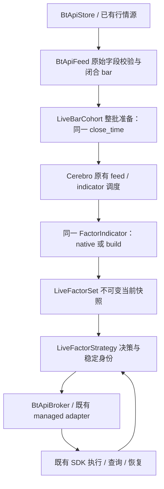

# 迭代50：设计与实施计划

日期：2026-10-23；版本：v0.1。状态：**设计稿，未实现、未运行验收**。分析基线见 [README](README.md)，验收唯一入口见 [验收方案](验收方案.md)。

## 1. 目标与首版边界

目标是让同一份因子定义在离线研究和实时普通 bar 策略中复用：历史补数完成预热，之后每个合格闭合 bar/cohort 更新因子，由策略读取当前结果并通过既有 BtApi 执行链发出有身份的订单，持续接收回报并支持受控恢复。

首版包括：单品种和静态多品种集合；同一频率、交易日历与价格口径；native/build 两种模式；OHLCV 因子与显式提供额外字段的因子；历史→实时切换；有限迟到、缺格、断线恢复；有界内存；普通 bar Cerebro 与一个已经选定的执行路由。单品种是相同 cohort 合同的退化情况，不维护第二套运行器。

首版不包含：未闭合 bar 反复修订、逐 tick 重算分钟因子、replay/resample、混合频率、运行中改变目标集合/分组/公式、跨账户原子组合单、高频延迟承诺、在线训练/IC/标签计算，以及修建新的交易服务拓扑。运行中的字段值可以按因果规则更新；改变字段定义、日历或组配置需要新运行并完成对账。现有用户自定义因子仍须声明并验证其输入、历史和恢复能力，不能把 Alpha101 的有限窗口证明外推到任意递归状态因子。

## 2. 已核实的源码差距

以下位置均相对仓库根，行号属于上述分析基线；实现时以函数名重新定位。

| 位置 | 当前事实 | 本轮处理 |
|---|---|---|
| `backtrader/research/factor_strategy.py:96,160,226` | 初始化拒绝 live/replay/resample，采集要求固定 ResearchSpec 网格 | 保留；抽出装配公共部分，新增实时入口 |
| `backtrader/research/factor_indicator.py:343,366` | `bind()` 复用原生指标构造；显式字段、组等较完整能力在 `_bind_for_research()` | 共用内部装配，不复制绑定和 mode 逻辑 |
| `backtrader/research/strict.py:97` | 严格源检查只接受可检查的 `p.dataname.columns` / `_colmapping` | 增加明确的流式源校验路径，禁止 `strict=False` 绕过 |
| `backtrader/research/factor_indicator.py:587` | 每次计算追加调用时间；固定网格检查依赖完整列表 | 离线默认保留；实时使用计数与有界样本 |
| `backtrader/research/operators.py:56,360` | 面板值/reason 可直接按 target 的物理 `_idx` 读取另一条 line.array | 审计不同 maxlen 的循环缓冲区；增加逻辑时点一致的读取分支 |
| `backtrader/research/factor_indicator.py:664` | membership 依赖离线 alignment 元数据；没有 present 数组时默认存在 | 实时绑定明确的当前格 present line，不能把迟到数据当当前成员 |
| `backtrader/research/sink.py:180` | CsvSink 继承 MemorySink，在 finalize 时输出整张面板 | 不用作无限实时存储；复用已有事件日志并增加小型决策记录 |
| `backtrader/feeds/btapifeed.py:979,1035` | Feed 有闭合 BarEvidence 校验，但 `_live` 入队只保留 OHLCV 等基础字段 | 在 opt-in 路径保留有来源的不可变 bar envelope，避免在策略从 lines 反造证据 |
| `backtrader/feeds/btapifeed.py:1472,1552` | tick 聚合用 watermark 闭合；line datetime 当前传 bucket_start；INVALID 不交付 lines | 实时因子明确使用 close_time，并保留无效/缺失格，旧默认行为不变 |
| `backtrader/stores/btapistore.py:1745` | `_normalize_bar()` 做基础字段转换，不保留来源、闭合质量和附加字段 | 因子 opt-in 路径在转换前校验并保存 envelope，不全局改写旧调用行为 |
| `backtrader/_cerebro/runnext.py:339,354,412,520` | 逐 Feed 前进，任一有数据即可触发策略；另有 `_check` 和重试 | 增加显式 cohort 的整批准备/校验接点，不能依赖轮询碰巧同时返回 |
| `backtrader/cerebro.py:635` | live 已关闭 preload/runonce | 复用，不新建调度循环 |
| `backtrader/brokers/btapibroker.py:3428,3545,3664` | 准入、Store 提交和 UNKNOWN 保留已存在 | 只接因子决策上下文；不复制订单状态机 |
| `backtrader/stores/service_execution_recovery.py:73,255` | 已有提交前持久 intent、事件游标和至少一次 callback 恢复 | 复用；补充因子决策到既有 intent 的关联，不创建第二套订单 outbox |

源码入口：[因子绑定](../../../../../backtrader/research/factor_indicator.py)、[研究策略](../../../../../backtrader/research/factor_strategy.py)、[严格检查](../../../../../backtrader/research/strict.py)、[算子](../../../../../backtrader/research/operators.py)、[Feed](../../../../../backtrader/feeds/btapifeed.py)、[Cerebro循环](../../../../../backtrader/_cerebro/runnext.py)、[Broker](../../../../../backtrader/brokers/btapibroker.py)、[Store](../../../../../backtrader/stores/btapistore.py)。

## 3. 总体设计与复用边界



`LiveBarCohort` 只协调行情交付；`LiveFactorSet` 只装配和读取指标；`LiveFactorStrategy` 只处理就绪、业务决策与身份关联。三者都不能手动调用因子 `next/once/advance`、伪造交易回报或另开一条计算时间循环。

保留离线研究入口，包括现有网格、FactorPanel、评价与 fincore；保留普通 Indicator 和未配置 cohort 的 BtApiFeed 行为。不会通过把 `FactorStrategy._validate_clocks()` 注释掉来实现 live。

## 4. 配置、装配与公开接口

拟议新增 `backtrader/research/live.py`，集中放置薄接口，避免为每个因子创建运行脚本：

| 拟议接口 | 职责 |
|---|---|
| `LiveFactorPlan` | 不可变 targets/groups、FactorSpec 列表、日历/频率/价格口径、预热和迟到预算、字段来源合同、诊断容量；不带凭证 |
| `LiveFactorSet.bind(plan, datas)` | 在策略初始化的 OwnerContext 内调用共用绑定逻辑，保留实际 mode、实例和子图身份；不自行运行 |
| `LiveFactorSet.snapshot()` | 在引擎推进完当前批次后读取完整 value/status/输入批次身份；不重算 |
| `LiveFactorStrategy` | 普通 Strategy 的薄基类，在 prenext/nextstart/next 中维护状态；只对可交易快照调用 `on_factors(snapshot)` |
| `LiveFactorStrategy.submit_factor_order(...)` | 校验当前 decision、生成/关联既有 managed 身份，再委托原 `buy/sell/cancel` 接口 |

接口关系示意（拟议，不是可运行示例）：

```python
spec = FactorSpec("alpha101", get_alpha(101), "factor", mode="build",
                  field_bindings={name: "feed:target:" + name
                                  for name in ("open", "high", "low", "close")})
plan = LiveFactorPlan(targets=("asset_a",), factors=(spec,),
                      frequency="1min", calendar_id="explicit-calendar",
                      price_basis="explicit-price-basis")  # 省略其余拟议配置
# 部署装配创建真实 BtApiStore / BtApiFeed / BtApiBroker，并绑定同一 cohort。
# 普通 Cerebro 负责计算；策略作者只实现 on_factors(snapshot)。
```

`LiveFactorPlan` 不复制 `FactorSpec` 的参数、源码指纹、profile、direction、mode 和 H 校验。提取一个内部 `_binding.py`，共用字段解析、按组构造、target/benchmark 分离和输出选择；`FactorStrategy` 继续提供有限 grid，live 提供开放式时钟及流式源合同。`ResearchSpec` 不接受 `end=None`，也不伪造无限 DataFrame。

首次实现只接受一个普通 bar Cerebro 中一个 cohort。cohort 包含所有参与时钟的目标和命名辅助 Feed；禁止另加不属于 cohort 的 Feed 触发旧因子反复计算。公式组可以是 cohort 的子集；组定义复用原语义。多个独立 cohort、过滤器改写时戳、replay/resample、oldsync、cheat-on-open 与 channel mode 在接管资源前明确拒绝，不静默降级。

`direction` 仍是显式信号方向，因子原始值不能悄悄取反。策略可按配置使用方向后的值。多因子合成首版只接受用户已冻结的确定性策略函数/权重；不把 fincore 的历史标签、拟合、全样本排名或评价函数放进实时循环。

## 5. 原始行情、字段与时间合同

### 5.1 不可变 bar envelope

复用现有 Feed 的 BarEvent/BarEvidence 和质量校验，增加同一入队项携带的来源信息，而不是从可变 line 反推：

- `instrument`、实际 Feed、来源标识、连接 generation、源序号、原始 bar ID。
- `bucket_start`、`bucket_end`、`available_at`、交易日/session、calendar/rules、时区与 clock domain。
- OHLCV/openinterest 和已声明附加字段；闭合、完整、质量、volume 语义与 present 状态。
- 历史/实时/恢复补数角色、来源字段的有效时点与可用时点。

这些是业务数据合同，不引入新的源码 pin/进程审计系统。来源明确缺字段时拒绝准入，不把默认值当真实观测。SDK 端确实不提供必要事实时记录为该路由依赖缺口；先修一个已选路由，不同时扩张全部 provider。

当前 `closed_bar_evidence_provider` 只覆盖 tick 聚合闭合路径，`_load_history()` 和直接 `store.poll_live()` bar 不自动拥有同等证据。实现必须逐一接入 history、tick-built、direct-bar 三种来源的校验/适配；无法提供来源合同的路径明确拒绝。历史输入可由明确的已对齐公开数据预热，但不能给它伪造实时 quote revision。cohort 从第一条预热数据就生效，不能只在切到live后才开始同步。

### 5.2 严格检查必须早于转换

在原始历史/live payload 进入 `_normalize_bar()` 或 LineBuffer 之前验证必需字段存在、类型、有限值和基本 OHLC/volume 语义；INF、错误类型、缺字段不得经 `_coerce_float` 或普通 line 容错变成零。显式缺格可含 NaN，但必须有独立 gap 状态，不能冒充真实 bar。

严格因子源校验新增“由实际 Feed 逐条校验的流式合同”分支。此分支要求已注册的具体 Feed 实例、所选字段和实际交付记录一致；一个 `validated=True` 标记不够。离线表源检查维持原规则。计算期继续使用 `FactorComputationContext`、既有异常传播和 infinity 拒绝，不通过公开 `bind()` 的 `factor_name=None` 规避严格模式。

### 5.3 时间和字段口径

实时因子以 UTC `bucket_end/close_time` 作为计算 grid key；现有 Feed 默认 bucket_start 不全局改变，仅启用明确的因子 bar profile。保留 start/end/available_at 三者，订单只能发生于数据实际 available 之后，不能以 grid 时间声称提前可交易。已有 bar 回调仍保持原事件意义；恢复 quote 绑定必须对应最终交付的 line datetime 与该 bar，不能借用等待期间更新的“最新 quote”。

历史预热和实时行情必须使用相同频率、交易日历、价格复权、成交量单位、合约乘数与字段定义。股票日线因子改用期货分钟线是新的使用配置，不是论文日线复现。

额外字段沿用 `FactorSpec.field_bindings` 与既有 `adv/vwap_volume` 派生：存在真实独立 VWAP 时直接使用；缺 VWAP 不用 OHLC 均价冒充。市值、行业等需有可用时间与生效时间，按决策时可知值接入普通扩展 Feed line；超过 freshness 预算或尚未生效则不可用。命名 benchmark 不自动加入输出资产或横截面池。全101源码流式验收可以使用完整合成字段；真实场景按依赖检查列出可运行子集与拒绝原因，不另建一份可漂移的101公式目录。

## 6. 在指标计算前同步，而不是事后屏蔽下单

### 6.1 最小引擎接点

新增通用小模块 `backtrader/feeds/live_bar_cohort.py`，由显式加入 cohort 的 BtApiFeed 使用。保留原 tick 聚合、订阅和历史取数，仅拆出“有预算地取得待交付 envelope”与“写入 line”两个阶段。

在 `Cerebro._runnext()` 的 feed advance **之前**增加 opt-in `prepare_round()` 接点：在同一运行线程内有界轮询全部成员，准备一个最早尚未消费的不可变 batch。没有批次时所有成员本轮均返回 None；成员 `_load/_check` 不能在本轮中途私自发布另一批。在所有 Feed 完成原有 `next()` 后、任何 indicator/Strategy 调度前检查 batch 的时间、成员、序号、交付次数一致，再允许正常 `_next()`。

cohort 模式下，`prepare_round()` 是行情消费、历史队列取数和 bar 闭合的唯一入口。成员 `_load()` 只交付已封存 batch 中属于自己的 envelope；无可交付项时立即返回 None，不再轮询、排空 tick/orderbook、闭合 bar、睡眠或派发事件。成员 `_check()` 只做不消费行情的状态检查，不沿用原先排空 tick、闭合 bar 的副作用；包括 retry 和所有 Feed 返回 None 后的 `_check()` 路径。来源结束也由 coordinator 统一记录，排尽完整 batch、处理尾部缺格并核验收尾后，才能通过明确的 cohort 结束状态返回 EOF，不能让某个成员自行提前结束。未启用 cohort 的原行为保持不变。

每个成员每批只交付一次，整个 batch 完成前不开放下一批。中途某个 Feed 异常或意外 filter/rewind 导致半批交付，则终止该计算 epoch，保留诊断并进入恢复，不继续算、不人工回滚指标。验证覆盖原循环的 retry、`_check`、EOF、single-data 分支；不能把 None 当 EOF，也不能仅依据 `any(drets)` 通过 cohort。关闭功能时走原路径。

候选暂存时不发 `notify_bar`。完成整批line交付并通过校验后，再统一分发原事件，随后进入原Broker/Strategy顺序；事件对象及已验证证据关系必须保留，不能复用已结束的旧dispatch token。候选Feed在释放前暂停消费后续tick，保留闭合时真实quote观察；交付时才用既有接口冻结到最终bar index/datetime，绝不误取等待期间更新的最新quote。来源队列必须有界，等待过久导致过期/溢出时冻结运行，不无限积压。

现有 `backtrader/feeds/barrier.py::MultiLegBarBarrier` 的 BarEvidence 和失败分类可复用，但它只接受2～3腿并有跨腿generation等一致条件，不能直接充当任意资产数的line调度器。cohort需逐来源固定generation/序号；不同Feed的合法generation可以不同，不机械要求相等。

等待批次期间保留 `_storenotify/_datanotify`、Broker 的无 bar 轮询、订单回报和 `notify_idle`。`prepare_round()` 必须有每轮数量/时间预算并及时返回；禁止阻塞等待全部行情，cohort 成员也不能逐个执行 `_qcheck` 睡眠。空批次轮次完成 Broker/idle 工作后，coordinator 必须执行一次统一、有界的等待或退避，避免连续空轮忙轮询；行情到达、停止信号或 Store 通知可提前唤醒，并防止检查队列与进入等待之间丢失唤醒。等待上限取配置空闲间隔、下一次订单轮询和续租截止时间的最小剩余预算；已有待处理事件或已到截止时间则立即返回处理。等待只放在这个位置，不与prepare或各Feed等待叠加，尤其不能阻塞 ServiceExecutionSession 的续租线程。

这是原循环的行情交付接点，不是第二个调度器。由于确实涉及引擎代码，验收需覆盖通用多数据/时钟回归，不能仅跑新增因子测试。

### 6.2 grid、迟到和缺格

运行持有显式日历及可滚动补充的未来 session 区间；不从“已收到哪些 bar”推断完整网格，不以 `now()` 自动造交易日。日历无后续区间时停止新开仓并请求补充，不无限外推。

- 同一 grid 的所有必需成员到齐且 envelope 合格时封存 batch；晚到先缓存，不能越过未处理的较早 grid。
- 超时使用单调时钟预算判断“等待已到期”，不伪称 provider watermark 已前进。依据已知日历产出明确 gap 行，数值为 NaN、present=0、缺失原因单列；不前填、不把窗口压缩成“最近N个有交易的bar”。
- 已交付时点的迟到、重复完全相同数据只记录/去重，不改写指标历史；同一语义 key 内容冲突停止该 epoch。自动更正历史值需要重建状态，不在运行中回填并继续交易。
- 源断线/generation变化保留证据，冻结新交易，使用受控补数；旧连接迟到事件不能进入新 epoch。generation 是来源事实，不是重新交易同一 grid 的理由。
- 第一版采用 **全 cohort 交易就绪**：任一必需成员缺格/质量失败则这一批没有交易决策，公式仍按显式 membership 与 NaN 规则推进。未来完整输入恢复后，还须等待相关滚动窗口重新有效。允许剩余资产参与公式计算，不代表允许对缺失截面交易。
- gap 行不能成为下单价格、行情新鲜度证明或真实成交事件；交易/估值使用现有权威账户与 quote 路径。对 Broker 处理无效价格的行为纳入组合测试，不能由因子层悄悄把 NaN 改为上一价。

membership 改为绑定实时 present line；离线 alignment 的现有实现保留。valid bar 的时间、value、reason 与成员资格必须在同一批次上读取，不能单独修最终输出而留下被污染的滚动子节点。

gap继续推进属于必须新验收的能力。R2尚未通过gap组合检查前遇到gap即冻结epoch；全101的NaN/membership和Broker无效价格检查通过后才启用该profile的继续推进。未验收gap语义的普通自定义子指标采用冻结后重建，不能默认为安全恢复；被calendar明确排除的非交易时间不生成gap。

## 7. 预热、状态与恢复

| 状态 | 计算 | 因子开仓/调仓 |
|---|---|---|
| INITIALIZING | 尚未装配完整 | 禁止 |
| WARMUP | 按同一网格、同一原生图重放历史 | 禁止，历史信号不补下单 |
| CATCHING_UP | 处理连接建立前/重连积压 | 禁止，直到同一 live cutover 与 freshness 条件满足 |
| LIVE_READY | 本批输入、窗口、字段、执行准入均合格 | 可调用一次业务决策 |
| DEGRADED / RECONCILING | 缺格、断线、UNKNOWN 或恢复未完成 | 禁止新风险；查询/回报和既有已授权风险处置继续 |
| STOPPING / STOPPED | 停止新批次，按原生命周期关闭 | 禁止新增决策 |

不能只看 `data.LIVE`：Feed 可能收到 tick 就发出 LIVE；就绪要求所有成员已越过确定的 cutover、当前批次闭合且新鲜、实际 lookback 与值状态合格，并且 Broker/SDK 原有准入通过。`prenext` 可以计算和记录不可用状态，但不能被误当“已经可交易”。

预热长度至少满足因子声明 H、原生 minperiod 和真实依赖跨度，包含已声明派生字段的窗口；NaN 不强制填零。恢复优先重建新的计算 epoch、重放来源明确的历史序列，不 pickle 任意 Strategy/Indicator 对象。Alpha101 的有限依赖窗口可在独立等价证明后只重放所需历史；EMA等递归自定义因子不得仅凭 H 截短，必须从固定 genesis 重放，或提供另行验收的确定性状态恢复。没有足够历史或输入版本不一致则保持不可交易。

提取并复用 `FactorStrategy._window_is_complete()` 的当前格及字段历史完整性合同，live用固定长度有效性环形状态实现；不能仅以最终输出恰好有限就宣布预热完成。额外派生字段和命名输入同样进入该检查，保留原来对缺格的保守判据。

重启顺序：获取既有执行消费者/运行范围所有权 → 对账订单/持仓及 UNKNOWN → 校验配置和来源 → 预热/补数 → 跳过已经封存的决策 key → 新的完整 live batch 才恢复决策。重放过程不重新执行历史订单。跨进程收到回报重复属于既有至少一次 callback 合同，消费端必须幂等，不能声明所有业务副作用 exactly-once。

## 8. 从因子到订单：补关联，不重写交易系统

### 8.1 当前快照和决策

实时快照只包含当前批次，采用不可变值：运行/配置身份、cohort/grid key、输入来源与 available_at、每因子每资产 raw value、direction、计算有效性、执行就绪原因、实际 mode。区分 `WARMUP/MISSING_INPUT/STALE/DOMAIN_ERROR/COMPUTE_ERROR/READY` 等状态；优先复用现有 OperatorReason，不把普通NaN臆测成某个具体错误。原实现没有可追溯 reason 的输出应记录 `OUTPUT_UNAVAILABLE`，而不是伪造 READY。

`on_factors(snapshot)` 是用户业务扩展点，可实现阈值或静态权重组合及目标仓位；本迭代不默认某个因子方向一定盈利，不自动把因子值当订单数量。首个示例使用明确的固定最大持仓/最小变动与一单在途约束，不默认目标百分比账户估值可用。

### 8.2 稳定身份与重复抑制

业务 key 建议为 `(account_scope, strategy_scope, logical_run_id, config_fingerprint, cohort_id, close_time, decision_kind)`；子订单加 instrument/side/position_effect/leg。来源 generation、进程启动ID和重试次数只作证据，不进入“同一市场时点能否再交易”的去重语义。重新连接不能生成一套新意图重下旧信号。

决策先持久记录，再调用提交；复用/扩展现有 `ServiceExecutionRecoveryJournal` 的同一存储边界，为决策保存稳定 signal ID、不可变目标/子意图集合、无操作决策、执行状态和与既有 intent 的关系。持久决策与订单 prepare/RPC之间的崩溃窗口必须逐一处理：已知未发出才允许继续原 intent；发出与否未知时保留原 ID 并查询，绝不以新ID重试。相同 key 不同内容是冲突，不覆盖。

实现接点是既有namespace/owner lease下的 `prepare_decision` 事务和唯一业务key：先固定各子意图的ID、数量/价格/position_effect/metadata版本、有效期，再关联既有 `prepare_intent`，不能重启后按新行情重建同一ID的payload。无既有durable execution恢复能力的route只允许shadow或明确的受限会话，不宣称崩溃后自动交易已支持。重启后已过期且可证明未发送的决策记为未发送过期；结果未知的子意图先对账，不因整个decision过期就假设订单不存在。

这里不创建第二套订单、成交或余额真相。Store/SDK 仍负责准入与派发，Execution/现有 Broker 回报是成交依据。`TradeLogger` 继续记录订单/回报与运行事件；它不是订单去重数据库，新增因子快照日志也不能取代持久决策。

首版每个资产最多一个未决因子意图；新信号到来时先核对当前持仓、在途剩余量和既有订单。明确终结后才重新计算下一决策；UNKNOWN/撤单UNKNOWN不自动撤换或重下。不要直接每根bar调用 `order_target_size()` 就认为已涵盖在途订单。多资产批次的多个订单是独立提交，部分成功时进入对账，不宣称原子组合成交。

### 8.3 执行入口与最小修改

优先选择已经存在的一个可用 deployment 路由。普通 `buy/sell/cancel`、Store的路由身份、Broker预检/权限/冻结/UNKNOWN处理全部保留；配置了 ServiceExecutionSession 的部署继续由它管理 runtime，未配置者不能被强迫启动新服务。`ServiceReadProxy` 仍只读，不能与可写会话混用；CTP direct write 仍禁用，使用现有 typed managed 路由。没有可用交易路由时最多接受影子模式，不为因子项目重建账户基础设施。

对显式注册的因子交易策略，在 Broker 提交前增加最小当前决策校验：owner、batch、有效窗口、decision ID、所需字段、当前交易状态相符；未注册普通策略保持原行为。这项检查是新增因子前置条件，不代替原交易授权。原有明确授权的风险减少/撤单路径与普通因子开仓分开，不能因没有新行情就阻断已有订单查询和风险处置，也不能借此扩大授权。

## 9. 有界存储、性能与错误传播

实时采用 `runonce=False, preload=False`，并将验证通过的 `exactbars`/qbuffer配置作为运行 profile。live 诊断使用总调用计数、首末时间和固定容量环形样本；离线默认仍可验证完整 call_times。不得只限制诊断列表，而让所有 line、行情pending、日志队列或Broker终结订单历史无限增长。

针对 `_read_panel_value()` 与 `_associated_reason()`，区分离线完整数组与实时循环缓冲；按来源line自己的逻辑位置/同期batch读取值与reason，验证源与目标时点和保留范围，不能把一个line的物理_idx直接套在另一个不同maxlen的deque上。优先在研究算子适配层修复，数值公式不变；只有实证证明核心缓存合同不足时才改 LineBuffer，并扩大核心回归。

cohort pending格数、每轮poll数、诊断ring、快照日志队列均有配置上限；超限记录并停止新决策，不能静默丢bar后继续。终结订单在权威持久记录完成后才可按既有/新增窄接口归档并移出内存缓存；活动/UNKNOWN/未确认callback不得被淘汰。若该执行路由尚无安全终结订单回收，则明确限制会话最大决策数并按已验收恢复路径换会话，不能宣称无限长稳已通过。

不在实时线程计算完整 FactorPanel、IC、报告或对全历史DataFrame反复重算。日志/持久写入的阻塞预算必须可测；持久决策失败则不发新单。因子异常经现有严格异常传播使当批不可交易，保留原异常分类与正常关闭事实；不能吞异常后继续使用上一个因子值。

## 10. 拟修改文件及职责

| 文件/目录 | 变化性质与最小范围 |
|---|---|
| `backtrader/research/live.py`（新） | Plan、FactorSet、快照和普通实时策略薄入口 |
| `backtrader/research/_binding.py`（新） | 从现有 FactorStrategy 提取共享构造/字段/分组；不改变公式 |
| `backtrader/research/factor_strategy.py` | 调用共享装配；保留离线时钟与采集约束 |
| `backtrader/research/factor_indicator.py` | 流式上下文、present line和有界诊断；沿用原 bound class/mode/OwnerContext |
| `backtrader/research/strict.py` | 明确流式原始字段准入与运行时错误上下文 |
| `backtrader/research/operators.py` | 同期 value/reason 与 qbuffer读取适配；不改数学语义 |
| `backtrader/research/__init__.py` | 惰性导出新接口；导入不加载SDK、网络或fincore |
| `backtrader/feeds/btapifeed.py` | opt-in envelope、close_time、分离poll与line交付、历史/live来源和gap |
| `backtrader/feeds/live_bar_cohort.py`（新） | 一个cohort、开放式日历、原子可见batch、预算/去重/迟到 |
| `backtrader/_cerebro/runnext.py`、必要的 `registry.py` | 显式cohort注册、advance前准备、dispatch前完整性检查；复用正常loop |
| `backtrader/stores/btapistore.py` | 仅所需原始bar envelope传递接点；不重写SDK或改全局normalize默认 |
| `backtrader/brokers/btapibroker.py` | opt-in因子决策准入、关联和有界归档接点（若既有能力不足）；保留原状态机 |
| `backtrader/stores/service_execution_recovery.py`、`service_execution_adapter.py` | 因子decision到已有intent关联和恢复检查；仅选中路由需要时扩展，向后兼容既有schema |
| `backtrader/observers/trade_logger.py` | 必要时增加有限结构化因子上下文；不重造日志/监控系统 |
| `examples/live/factor_trading/`（新示例） | 复用现有entry tier/配置/账户准入；提供fake、shadow与显式demo入口和公开模板，无真实配置 |
| `tests/unit/test_factor_live*.py`、`tests/integration/test_factor_btapi_live.py`（拟新增） | 共用已有fixtures/oracle，覆盖新组合；不复制整个私有测试基础设施 |
| `docs/source/developer-guide/factor-live.md`（拟新增） | 使用方法、字段限制、所选路由、恢复和准确验收级别 |

默认不改101个公式类、fincore、SDK包或既有离线示例的计算语义。文件表是设计范围，不是授权同时改所有文件；每轮只改实证需要的项。后续发现必须改SDK时先在该包现有dev完成窄验收和提交，再更新父仓库gitlink。

## 11. 分轮实施与退出条件

| 轮次 | 实施范围 | 本轮退出条件 / 对应AC |
|---|---|---|
| R0 | 固定运行profile、字段/时间合同，确认一个真实部署路由；构造能复现不同步/strict拒绝/qbuffer风险的最小用例 | AC50-01；若路由缺失明确列依赖，不停滞源码工作、不扩服务拓扑 |
| R1 | 共用装配、流式strict、native/build、present与有界诊断 | AC50-02～05；离线回归；限定源码组件提交 |
| R2 | Feed envelope、close_time、cohort最小引擎接点、历史预热和gap | AC50-06～14；普通多数据/策略回归；限定行情组合提交 |
| R3 | qbuffer完整性、全101流式数值、数据因果与重建 | AC50-15～18；原公式数学保持；限定计算路径提交 |
| R4 | 当前快照、策略决策、既有Broker/intent关联、UNKNOWN/恢复 | AC50-19～24；真实Cerebro+Feed+Broker、fake外部叶子组合提交 |
| R5 | 流式记录、有界运行、安装示例 | AC50-25～27；明确源码/本机服务/安装分别通过并提交 |
| R6 | 真实行情无写影子，再执行明确授权的demo账户有限闭环 | AC50-28～30；一条路由独立记录，不能把fake作为账户通过 |

每轮先完成该轮验收、只暂存明确文件/hunk、提交对应dev，再开下一轮。若共享runner连续两次在case之前失败，先定位共同runner，不建立逐次放宽guard的新harness链。已经接受的历史QA不为归档而重跑；这里的新回归是为了新源码变化及新的组合边界。无根据的“几天完成”不列为交付承诺。

## 12. 完成定义

源码/本机交付要求 AC50-01～27 在对应层级通过，包括全101合成流式数值及实际BtApi组合；缺字段拒绝必须有效，不能用全部NaN或全部跳过通过。

一次完整的首条实盘路由交付还要求 AC50-28～30：真实行情影子、指定demo账户下单/撤单/成交与回报、受控恢复和收尾均有对应证据。只对实际测试的venue、环境、账户范围、因子集合、周期、mode和版本作结论。其他路由仍待验收；此结论不关闭历史三交易所/Optional16矩阵，也不表示资金实盘盈利、性能承诺或全101在该市场均有真实字段。
