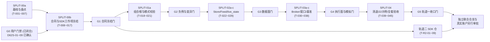

# 开发计划与实施清单：Backtrader 实盘 Direct 与 Gateway 拆分（v2）

> 日期：2026-11-23　状态：**门禁 G0 已闭合（2026-11-23 用户逐条确认 `D62S-01`～`D62S-09`） / 开发未开工 / REVIEW_PENDING**
> 上游与同套件文档：[需求文档 v3](需求文档.md)（`R62S-01`～`R62S-16`、已确认 `D62S-01`～`D62S-09`） · [设计文档 v2](设计文档.md) · [验收文档 v2](验收文档.md)。历史 v1 需求与五份评审报告归档于 [old/](old/)。
> 用法：开发者按门禁顺序自上而下认领；每项完成后勾选 `- [x]` 并在状态矩阵填写实际证据等级（`STATIC`/`UNIT`/`FAKE`/`INTEGRATION_SIM`/`PACKAGE`）、提交哈希与日期。**勾选仅表示开发自验完成，不等于验收通过；只有用户签收才产生 `ACCEPTED`**。任务严格执行小切片提交：**禁止一次提交同时搬迁模块和更改执行语义**。

---

## 0. 全局开发纪律与红线（所有任务适用）

1. **每步静态与回归硬门禁**（对齐 `.github/workflows/test.yml` 与迭代 71 `N72-18`）：
   - `ruff check backtrader/`（`ruff 0.16.2`）：**0 errors**；
   - `mypy backtrader --config-file=pyproject.toml`（目标 `python_version="3.8"`）：**0 errors**，**严禁新增 `ignore_errors = true`**；
   - `black --check --line-length 100 backtrader/`、`isort --check-only backtrader/`、`bandit -r backtrader -ll -q` 通过；
   - `pytest` 对照 `SPLIT-00a` 锚定基线（`2487275ab` 并行+串行 `6,070 passed` 及 471 删减清单审查结论）逐 test 比对，预存失败按 test id 登记为 `pre-existing`。
2. **Guard 变异检查（mutation check）纪律**：凡模式校验、拒收键、防互挂、单写者或 fail-closed 守卫，必须执行“临时移除守卫 → 目标负例失败 → 恢复源码 → 核对文件 SHA-256 一致”。
3. **UNKNOWN 与存量状态红线**：任何开发/测试不得清空 `pending.json` 行、重置账本、删除 `state/execution_routing.sqlite` 或篡改审计日志；严禁将 fake/sim 结果写成真实账户或 SimNow 结论。
4. **跨仓依赖与提交顺序**：
   - `backtrader/` 对 `bt_api_gateway`、`bt_api_risk`、`bt_api_execution`、`bt_api_monitor`、`bt_api_runtime`、`bt_api_transport_zmq` 维持 **0 直接导入**（`bt_api_runtime` 反向依赖 `back-trader-python>=1.4.0`，导入即循环依赖）；
   - 跨仓改动严格按 **`bt_api_base` → 子仓 → `D:/bt_api_py` 父仓 gitlink → `d:/source_code/backtrader`** 顺序提交；仅暂存本轮接受的文件或 hunks，保留一切无关 dirty 改动。
5. **门禁前置纪律**：门禁 **G0（用户逐条确认 `D62S-01`～`D62S-09`）** 未闭合前，只允许执行只读基线盘点（`SPLIT-00a` `T-001`～`T-007`），**严禁冻结 `SPLIT-00b` 合同或启动任何产品代码改造**。
6. **中文文档编码纪律**：本仓新增/更新中文 Markdown 默认使用 **UTF-8 BOM**，严格 UTF-8 解码无替换符（`\uFFFD`），并用 Windows PowerShell 5.1 默认读取确认中文可读。

---

## 1. 阶段门禁总览（G0–G5）与双轨依赖图

| 门禁 | 关闭条件 | 解锁范围 | 当前状态 |
| --- | --- | --- | --- |
| **G0** | 用户逐条确认 `D62S-01`～`D62S-09`（含 `Q9b/c` 两处故障留白与存量清退审批人）并写入修改记录 | `SPLIT-00b`（`T-008`～`T-017`）与轨道二登记 | **已闭合（2026-11-23）** |
| **G1** | `SPLIT-00a` 证据档案 + `SPLIT-00b` 全部 `contracts/*.md` v1 评审冻结，且 `S-01`～`S-12` 判定对象 100% 存在 | `SPLIT-01a` 代码实现与轨道二并行开工 | 未闭合 |
| **G2** | `S-01` 配置笛卡尔全量正负例 + mutation check + `S-06`（兼容壳子集）通过 | `SPLIT-02a–c` Store/Feed/`live_state` 提取 | 未闭合 |
| **G3** | `S-02`（数据面）、`S-06`（Store/Feed 子集）、`S-08`（`mode` 印记子集）、`S-10`（Feed parity 与日历端口）通过 | `SPLIT-03a–c` Broker 提取与故障注入 | 未闭合 |
| **G4** | `S-02`～`S-05`、`S-06`、`S-10`（统一停止摘要）、`S-11`（最小性能守门）与 wheel 兼容通过 | `SPLIT-04` 清退、示例迁移与发布前验收 | 未闭合 |
| **G5** | `S-01`～`S-12` 轨道一离线/模拟验收全部达标且无 `FAIL`；**同时**轨道二 `T-R2-01`～`T-R2-09` 与迭代 66/68 关键门合龙前，Gateway 真实账户保持 `NO-GO` | 报请用户组织独立联合验收（真实账户操作另行审批） | 未闭合 |

---

## 2. 详细任务清单（T-000a～i、T-001～T-045、T-R2-01～T-R2-09）

### 阶段 0：用户决策门禁（已于 2026-11-23 逐条确认闭合）

- [x] **T-000a（`D62S-01`）**：已选 **方案 A（代理转发链，兼容 `D64-02` 与 `D63-17`）**（2026-11-23）。
- [x] **T-000b（`D62S-02`）**：已确认 **两层五组件全备语义**（部署级全备 + 策略进程不建 Monitor/Runtime RPC；Monitor 经 `monitor_required` 就绪证明；Runtime 维持 `D66-02` 且迭代 66 为 Gateway 实盘放行前置）（2026-11-23）。
- [x] **T-000c（`D62S-03`）**：已确认 **服务端强制收紧（取代 `D63-37` 默认值）**（策略 principal 仅保留查询与委派撤单、不开直接报单权，只允许 Risk 代理向 Gateway 报单）（2026-11-23）。
- [x] **T-000d（`D62S-04`）**：已确认 **严格 Gateway 禁止 `risk: "none"`**（Risk 必配，取代 `D64-01` 的 none 选项；Risk 不可用拒开平放行委派撤单）（2026-11-23）。
- [x] **T-000e（`D62S-05`）**：已选 **方案 A2（全量经 Execution，扩展透传）**（全部订单必经 Execution、取消 `DIRECT_PATH` 旁路取代 `D65-02/10/15`，轨道二新增 `T-R2-09` 为 Execution `PASS` 扩展市价/条件单透传支持）（2026-11-23）。
- [x] **T-000f（`D62S-06`）**：已确认 **授权拆分 `BtApiBroker` 源码**为薄 Base + Direct/Gateway 两套实现（取代 2026-11-12“源码不变”限制）（2026-11-23）。
- [x] **T-000g（`D62S-07`）**：已确认 **按 SPLIT-04 清退退役路径 2/3/5 并由 `DirectBtApiStore` 拒收路径 6 三键**（存量库只读导出不删库）；存量未决库清退审批人为 **项目/账户负责人（用户本人）逐案书面审批**（2026-11-23）。
- [x] **T-000h（`D62S-08`）**：已确认 **保留两模式只读预演态并剥离 `ServiceReadProxy`/`local_replay`**（`cohort` 仅限 Direct/研究）；**公开 6 个具体类 + 显式组合根工厂 + 保留兼容壳至迁移完成**；**维持 `D63-10`**（Gateway 首期仅 CTP）（2026-11-23）。
- [x] **T-000i（`D62S-09`）**：已确认 **默认单进程单模式**（四层互斥）；**Execution 不可用时 fail-closed 拒绝新平仓/减仓单**；**Runtime 失联时已运行策略照常**（平仓/撤单放行）（2026-11-23）。

---

### SPLIT-00a：只读基线与全量盘点（G0 前即可启动，仅只读分析与证据归档）

- [ ] **T-001 双仓基线与核心文件哈希锚定**（关联：`R62S-16` / 验收：`S-07`）
  - **目标**：记录 Backtrader `dev` HEAD（现 `575e9ddcaf936cc6062a2d0f72aadb6a29d29831`）、`git status --porcelain`、五大实盘文件（`btapistore.py`/`btapifeed.py`/`btapibroker.py`/`_btapi_direct_mode.py`/`_btapi_gateway_stream.py`）SHA-256 与全量测试基线（`6,047 + 23 = 6,070 passed`）。
  - **产出**：`evidence/baseline.md`。
- [ ] **T-002 `2487275ab` 删减测试清单审查**（关联：`R62S-16` / 验收：`S-07` 前置）
  - **目标**：导出 `git show --name-status --diff-filter=D 2487275ab` 完整 490 文件清单（已实测为 `tests/` 471 个：`tests/unit/` 431、`tests/integration/` 39、`tests/test_iter64_direct_risk_options_fake.py` 1 + `docs/` 19 个），区分历史 `test_iter*` 冗余用例与实盘支撑/关键合同覆盖，识别是否存在需补测的实盘覆盖缺口。
  - **产出**：`evidence/test_deletion_audit.md`。
- [ ] **T-003 权威 SDK 基线与 9 包版本快照**（关联：`R62S-16` / 验收：`S-07`）
  - **目标**：锁定 `D:/bt_api_py`（`dev @ 53d3ebe6`）为唯一权威 SDK checkout（显式排除 `D:/source_code/bt_api_py`），采集 109 处 dirty 摘要、21 子模块 `git submodule status`（含 `+` 偏离的 `bt_api_gateway` 与 `bt_api_transport_zmq`）及 9 个核心包的版本与 `requires-python`（对齐设计文档 §11.1）。
  - **产出**：`evidence/sdk_baseline.md`。
- [ ] **T-004 九路径全量调用方与存量状态盘点**（关联：`R62S-03`, `R62S-12` / 验收：`S-08` 输入）
  - **目标**：针对需求文档 §3.2 全部 9 条路径，核实生产/示例/测试调用方与跨仓引用（特别是 `bt_api_runtime/assembly.py` 对 `ServiceReadProxy` 的引用、`btrun`/`research/live.py` 对无 SDK 夹具的引用、路径 5 三参数 0 外部调用 vs 44 个 `FakeStore` 单测、以及路径 4/5 共用 `_execution_parent_projection.py`/`_execution_routing_apply.py` 的边界）。
  - **产出**：`evidence/path_disposition.md`。
- [ ] **T-005 分流关键字全量扫描**（关联：`R62S-01`, `R62S-07` / 验收：`S-09`）
  - **目标**：以 `_gateway_mode`、`_service_read_only`、`_execution_parent_port`、`_direct_write_mode`、`_service_execution_session`、`_managed_runtime_session`、`_is_market_data_only`、`position_mode`、`_gateway_strategy_config`、`_replay_tick_adapter`、`cohort_source_mode` 为检索集合，扫描 `stores/`、`feeds/`、`brokers/`、`service/`、`execution/`、`live_state/`、`live_trading/` 全量切点。
  - **产出**：`evidence/mode_cutpoints.md`。
- [ ] **T-006 文档交叉链接与跨迭代决策号复核**（关联：`R62S-16` / 验收：`S-09`）
  - **目标**：脚本化校验本目录 4 份文档全部相对链接 100% 可达、全部 `R62S-*` / `D62S-*` / `T-*` / `S-*` 双向追踪零悬空、与迭代 60–71 现行文档决策号一致。
  - **产出**：`evidence/doc_link_check.txt`。
- [ ] **T-007 三张机制深度盘点清单**（关联：`R62S-07`, `R62S-13` / 验收：`S-04`, `S-06`；**SPLIT-03a 硬入口前置**）
  - **目标**：产出三张静态表：① **UNKNOWN 状态处理全仓分布图**（覆盖 `_btapi_direct_mode.py`、`_btapi_gateway_stream.py`、`_btapi_recovery.py`、`_btapi_owner_fence.py`、`live_state/pending.py`）；② **7 处 `isinstance(..., BtApi*)` + 3 处非绑定类方法调用审计表**（`BtApiStore.gateway_instrument_status`、`BtApiFeed.historical_warmup_active`、`BtApiFeed.gateway_trade_qualification`）；③ **Broker 共享状态表（字段 × 读写方 × 模式）**（`orders`、`notifs`、`positions`、`long/short_positions`、`_trading_enabled`、`_startup_ready`、`order.info` 字段集与 `super()` 委派链）。
  - **产出**：`evidence/mechanism_inventories.md`。

---

### SPLIT-00b：跨仓合同与工程工作项冻结（**强依赖门禁 G0**）

- [ ] **T-008 配置分层 Schema 与显式 `mode` 合同 v1**（关联：`R62S-01`, `R62S-02` / 验收：`S-01`, `S-09`）
  - **内容**：冻结公共/Direct/Gateway 三层 YAML 与 kwargs 字段路径、现行隐式判据迁移映射表、两模式完整拒收键清单（§2.2）及测试替身注入白名单。
  - **产出**：`contracts/config_schema_v1.md`。
- [ ] **T-009 配置笛卡尔负例 Fixture 清单 v1**（关联：`R62S-02`, `R62S-03` / 验收：`S-01`, `S-09`）
  - **内容**：枚举[验收文档 §3 S-01](验收文档.md) 全部正负例，逐字段与 `btapistore.py`、`D:/bt_api_py/bt_api_py/gateway_strategy_config.py`、`direct_api_assembly.py` 实际可接受键集静态对齐。
  - **产出**：`contracts/negative_fixtures_v1.md`。
- [ ] **T-010 五组件配置权威载体裁决 v1**（关联：`R62S-05` / 依赖：`D62S-02`, `D62S-04` / 验收：`S-03`）
  - **内容**：在[设计文档 §6.3](设计文档.md#63-服务端防绕过与-sdk-配置载体三选一裁决split-00b-输入) 三选一方案中唯一裁定（推荐方案 C：SDK `strict_five_component` profile + `GatewayReadinessProof`），冻结版本协商字段与四类预检错误分类（`UNREACHABLE`/`AUTH_FAILED`/`VERSION_INCOMPATIBLE`/`COMPONENT_NOT_READY`）。
  - **产出**：`contracts/five_component_authority_v1.md`。
- [ ] **T-011 `GatewayReadinessProof v1` 与派发前授权核对点合同**（关联：`R62S-04`, `R62S-05`, `R62S-06` / 验收：`S-03`, `S-04`）
  - **内容**：冻结 `GatewayReadinessProof` 中立 DTO 精确字段类型、有效期、签名/认证来源核验规则及三处具名授权核对点（BT→Execution/Risk、Execution→Risk/Gateway、Gateway 派发前）字段与错误码。
  - **产出**：`contracts/readiness_and_auth_proof_v1.md`。
- [ ] **T-012 全量类/Mixin/模块归属表与 `isinstance` 方案冻结**（关联：`R62S-07` / 依赖：`D62S-06`, `D62S-07` / 验收：`S-06`）
  - **内容**：基于设计文档 §2.4 & §3.2 定稿 `stores/`、`feeds/`、`brokers/`（含全部 12 个 `_btapi_*`/`_execution_*` 模块）、`service/`、`live_state/` 归属；验证 `ABC.register` / `__new__` 分派方案与 `StoreParams` / `ParameterizedBase` / `LiveFeedBase(ABCMeta)` 无冲突。
  - **产出**：`contracts/class_ownership_v1.md`。
- [ ] **T-013 公开 API 清单与兼容期合同 v1**（关联：`R62S-03`, `R62S-07` / 依据：`D62S-08b` 已确认 / 验收：`S-01`, `S-06`）
  - **内容**：按 `D62S-08b` 冻结 **6 个具体类**（`DirectBtApiStore/Feed/Broker`、`GatewayBtApiStore/Feed/Broker`）+ 显式组合根工厂 + 兼容壳（`BtApiStore/Feed/Broker`，保留至 SPLIT-04 后按弃用期处置）的公开导出清单、非实盘独立类（`ReplayBtApiFeed`、`ServiceReadOnlyStore`）路径及诊断错误类型归属。
  - **产出**：`contracts/public_api_v1.md`。
- [ ] **T-014 单写者作用域与并发栅栏合同 v1**（关联：`R62S-13` / 依据：`D62S-09a` 已确认 / 验收：`S-04`）
  - **内容**：按设计文档 §8 冻结 Direct 进程锁、Gateway 账户级/策略级租约、Execution 账户级进程的作用域与跨主机候选选型（本机 SQLite lease vs `account_writer_authority` TTL 租约），纳入单进程单模式栅栏与外部手工写者/跨主机残余风险声明。
  - **产出**：`contracts/single_writer_v1.md`。
- [ ] **T-015 九路径与旧混合清退表 v1**（关联：`R62S-12` / 依据：`D62S-07a/b` 已确认 / 验收：`S-08`, `S-12`）
  - **内容**：逐项冻结路径 2/3/5/6 配置键、`state/execution_routing.sqlite` 与历史 `pending.json` 归属、只读导出格式、fail-closed 拒绝动作，并固定**清退审批人 = 项目/账户负责人（用户本人）逐案书面审批**（严禁碰触路径 4 `state/gateway_execution_routing.sqlite`）。
  - **产出**：`contracts/retirement_table_v1.md`。
- [ ] **T-016 有限错误码与迁移指引文案表 v1**（关联：`R62S-02` / 验收：`S-01`）
  - **内容**：冻结全部启动期/运行期 finite 错误码（含 `MODE_REQUIRED`、`MODE_CONFLICT`、`PROCESS_MODE_CONFLICT`、`DIRECT_SERVICE_KEY_FORBIDDEN`、`GATEWAY_RISK_REQUIRED`、`GATEWAY_EXECUTION_REQUIRED`、`GATEWAY_DIRECT_PATH_BYPASS_FORBIDDEN`、`GATEWAY_PRINCIPAL_BYPASS_UNSAFE`、`LIVE_STATE_MODE_MISMATCH` 等）及可读迁移指引。
  - **产出**：`contracts/error_codes_v1.md`。
- [ ] **T-017 轨道二跨仓 SDK 工作项登记表**（关联：`R62S-04`, `R62S-05`, `R62S-06`, `R62S-16` / 验收：合龙前置）
  - **内容**：将 `T-R2-01`～`T-R2-09`（含 `D62S-05` 方案 A2 新增的 Execution `PASS` 市价/条件单透传扩展）逐项映射到 owner 子仓（`bt_api_base`/`bt_api_gateway`/`bt_api_risk`/`bt_api_execution`/`bt_api_runtime`/`bt_api_monitor`/`bt_api_py`）、依赖决定编号、契约替身接口及提交顺序。
  - **产出**：`contracts/sdk_workitems_v1.md`（仅界面冻结，不在本仓实现 SDK 代码）。

---

### SPLIT-01a：模式选择与组合根实现（**强依赖门禁 G1**）

- [ ] **T-018 实现单一组合根 `backtrader/stores/btapi_composition.py`**（关联：`R62S-01`, `R62S-02`, `R62S-03` / 验收：`S-01` 正例）
  - **落点**：新增 `backtrader/stores/btapi_composition.py`（名称以 `T-013` 为准）。
  - **要点**：实现不可变配置快照拷贝、显式 `mode` 校验、§2.2 两模式拒收矩阵、`LiveRunBinding` 不可变绑定令牌、测试替身受控注入白名单；兼容 Python 3.8 语法（`from __future__ import annotations`）。
  - **自验**：单测覆盖 Direct（自有/借用/只读预演）与 Gateway（正常/只读预演）全正例 + `ruff`/`mypy` 0 errors。
- [ ] **T-019 兼容壳构造委托与 `isinstance` 契约接线**（关联：`R62S-07` / 验收：`S-06` 子集）
  - **落点**：`backtrader/stores/btapistore.py`（`__init__` / `getdata` / `getbroker`）。
  - **要点**：保留 `BtApiStore`/`BtApiFeed`/`BtApiBroker` 公开导入与注册名；新组合根入口 100% 严检，旧壳按 `T-013` 委托组合根并标记弃用警告；验证 `isinstance(x, BtApiStore)` 数学成立。
- [ ] **T-020 `S-01` 全量负例测试落地与 Mutation Check**（关联：`R62S-02` / 验收：`S-01` 全量、解锁 **G2**）
  - **落点**：新增 `tests/unit/stores/test_btapi_mode_composition_negative.py`。
  - **要点**：将 `T-009` 清单全部负例（含网络连接前阻断埋点断言、不误杀 `application.direct_write` 的术语测试）落地为 pytest 参数化用例，并逐守卫执行 mutation check 留存哈希证据。
- [ ] **T-021 现有混合路径单测的过渡处置**（关联：`R62S-12` / 验收：`S-01`, `S-08`）
  - **落点**：`tests/unit/brokers/direct/test_direct_execution_routing.py`、`test_direct_execution_routing_apply.py`（44 个 `FakeStore` 单测）及旧托管路径相关单测。
  - **要点**：在 SPLIT-01～03 期间明确标注废弃过渡期或迁为路径 4（Gateway 执行路由）对照用例 + 路径 5 拒绝负例，不静默删除覆盖。

---

### SPLIT-02a–c：Store、Feed 与 `live_state` 提取（**强依赖门禁 G2**）

- [ ] **T-022 提取 `BaseBtApiStore`（SPLIT-02a）**（关联：`R62S-07` / 验收：`S-06` 子集）
  - **落点**：新增 `backtrader/stores/base_btapi_store.py`，重构 `btapistore.py`。
  - **要点**：承载框架注册、`run_binding`、公共生命周期与错误接口；**严格采用显式 `__init__` 形参风格，禁止引入类属性 `params`**（规避 `StoreParams` 不合并陷阱）；纯结构搬迁独立提交，不改业务语义。
- [ ] **T-023 提取 `DirectBtApiStore`（SPLIT-02b）**（关联：`R62S-02`, `R62S-07` / 验收：`S-02`）
  - **落点**：新增 `backtrader/stores/direct_btapi_store.py`。
  - **要点**：仅持有统一 SDK 自有/白名单借用会话与 `DirectApiAssembly`；在构造与装配两层显式拒收路径 6 三键（`market_runtime_factory`/`forwarding_config`/`transport_mode`）及一切服务/风险键；断言零加载 6 个可选 SDK 子包。
- [ ] **T-024 提取 `GatewayBtApiStore` 与就绪证明绑定（SPLIT-02b）**（关联：`R62S-05`, `R62S-06`, `R62S-07` / 验收：`S-03` 数据与预检面）
  - **落点**：新增 `backtrader/stores/gateway_btapi_store.py`，配合 `backtrader/service/gateway_config.py`。
  - **要点**：承载 `GatewayStrategyConfig`（strict 档位）、`GatewayPendingHost`、CURVE profile、`state/gateway_execution_routing.sqlite` 管理与 `GatewayReadinessProof v1` 校验；不建 Monitor/Runtime RPC 客户端；模块探测断言无 provider 原生交易模块加载；迁移 `btapifeed.py:1995, 2004` 的 `isinstance(store, BtApiStore)` 与非绑定调用。
- [ ] **T-025 提取 `MarketSourcePort` 与两模式实现（SPLIT-02c）**（关联：`R62S-08` / 验收：`S-10`）
  - **落点**：新增 `backtrader/feeds/_market_source_port.py`（或协议模块），拆分 `btapifeed.py` 中订阅/轮询/恢复原因/闲置等待（保留 `_GATEWAY_IDLE_POLL_SECONDS` 退避）/时钟资格。
  - **要点**：`_load()` 保持先投递已完成 `self._live` bar 再排空新 tick 的因果对；禁止在 `BaseBtApiFeed` 中出现 `if _gateway_strategy_config` 分支。
- [ ] **T-026 提取 `CalendarQueryPort` 与两模式实现（SPLIT-02c）**（关联：`R62S-09` / 验收：`S-10`）
  - **落点**：新增 `LocalCalendarQueryPort`（Direct）与 `GatewayCalendarQueryPort`（Gateway），更新 `btapifeed.py` 与 `service/trading_calendar_config.py`。
  - **要点**：保留迭代 67 `UNKNOWN` / `CALENDAR_SCOPE_UNAVAILABLE` fail-closed 语义；对 Gateway 混配本地 `calendars.feed_scope` 保持 `CALENDAR_SCOPE_CONFLICT` 负例测试。
- [ ] **T-027 提取 `BaseBtApiFeed`、`Direct/GatewayBtApiFeed` 与独立 `ReplayBtApiFeed`（SPLIT-02c）**（关联：`R62S-03`, `R62S-07`, `R62S-08` / 验收：`S-06`, `S-10`）
  - **落点**：`backtrader/feeds/btapifeed.py` 及新拆分模块；更新 `service/gateway_config.py:410` 与 `_btapi_gateway_stream.py:361, 365, 367` 的 `isinstance` 及非绑定类方法调用。
  - **要点**：`ReplayBtApiFeed` 彻底剥离出实盘 `BaseBtApiFeed`（保持 `store=None` 门禁）；`ServiceReadProxy` 剥离为独立非实盘入口；Gateway Feed 能力负例（拒绝 `backfill_start`/history/live/cohort/`orderbook_as_ticks`）全保持。
- [ ] **T-028 `live_state` 不可变 `mode` 印记与版本守卫（SPLIT-02c）**（关联：`R62S-11` / 验收：`S-08` 子集）
  - **落点**：`backtrader/live_state/identity.py`、`gateway_initialization.py`、`state_dir.py`、`cli.py`。
  - **要点**：`identity.json` 新增不可变 `mode` 字段（`IDENTITY_VERSION = 2`）；目录模式与当前进程模式不一致时抛 `LiveStateModeMismatch`（`EXIT_BLOCKED = 2`）；实现历史 v1 `identity.json` 与 Gateway `pending.json v5–v7` 的只读核验与空仓显式升级子命令（未升级/带仓/有未决一律 fail-closed）。
- [ ] **T-029 Direct/Gateway 数据面 Parity 回归（SPLIT-02c 收口）**（关联：`R62S-08`, `R62S-09` / 验收：`S-02` 数据面、`S-10`、解锁 **G3**）
  - **落点**：新增 `tests/unit/feeds/test_btapi_feed_dual_mode_parity.py`。
  - **要点**：使用同一规范化离线/合成数据，验证 Direct fake 场所与 Gateway fake 五组件在能力交集内的时间戳、OHLC、成交量质量标志、bar 顺序、恢复原因与 `runonce`/`runnext` 逐条一致，并验证各自专有负例。

---

### SPLIT-03a–c：Broker 提取、故障窗口与性能守门（**强依赖门禁 G3**）

- [ ] **T-030 实现统一停止摘要合同并准备退役示例私有翻译（SPLIT-03a）**（关联：`R62S-10` / 验收：`S-10`）
  - **落点**：`BaseBtApiBroker.get_shutdown_summary()`，对齐 `backtrader/live_trading/run_status.py` `OUTCOMES` & `EXIT_CODES`（0/1/2/3/4）。
  - **要点**：完整覆盖设计文档 §4.3 映射表（含 `market_data_only + OBSERVATION_ONLY + active_order_count==0 -> STOPPED` 与所有未确认组合 `-> UNKNOWN`）。
- [ ] **T-031 提取 `BaseBtApiBroker`（SPLIT-03a）**（关联：`R62S-07` / 强前置：`T-007` Broker 共享状态清单 / 验收：`S-06`）
  - **落点**：新增 `backtrader/brokers/base_btapi_broker.py`，重构 `btapibroker.py`。
  - **要点**：仅上提经对照证实语义一致的投影与通知逻辑（`StrategyLedgerBrokerMixin`、`StrategyNotificationRecoveryBrokerMixin`、`BrokerReconciliationMixin` 等）；`BaseBtApiBroker.params` 仅含共享参数，不吸收两种授权模型；小切片提交，验证 `ParameterizedBase` 描述符与 `super()` 委派链无回归。
- [ ] **T-032 提取 `DirectBtApiBroker`（SPLIT-03b）**（关联：`R62S-07`, `R62S-10` / 验收：`S-02` 全量）
  - **落点**：新增 `backtrader/brokers/direct_btapi_broker.py`，组合 `BtApiDirectModeMixin`（`_btapi_direct_mode.py`）。
  - **要点**：独立拼接 `params = BaseBtApiBroker.params + direct_params()`；验证 `waiting_orders`、`write_admission=False` fail-closed、对账/停止与 `get_strategy_position/cash/value` Direct 合同；不加载五组件。
- [ ] **T-033 提取 `GatewayBtApiBroker`（SPLIT-03c）**（关联：`R62S-04`, `R62S-06`, `R62S-07`, `R62S-10` / 验收：`S-03` 全量）
  - **落点**：新增 `backtrader/brokers/gateway_btapi_broker.py`，组合 Gateway 专属 Mixin（`_btapi_gateway_stream.py`、`_btapi_gateway_notifications.py`、`_btapi_gateway_projection.py`、`_btapi_gateway_events.py`、`_execution_parent_projection.py`、`_execution_routing_apply.py`）。
  - **要点**：按已确认的 `D62S-01`（方案 A）+ `D62S-05`（方案 A2）接线——**全部下单必经 Execution**，显式禁止并拦截 `ExecutionOrderRouter` 的 `DIRECT_PATH` 旁路与无 Risk 直达分支，不暴露 Direct `waiting_orders` 等参数，保留 `direct.delegated_cancel` 与母单恢复；对接契约替身五组件验证 `S-03a`（普通单含限价/市价/条件单走 `PASS` 透传 + `DIRECT_PATH` 拒绝）与 `S-03b`（切片母单走 `SLICE`/`TWAP`）。
- [ ] **T-034 协作进程单写者并发、单进程互斥与多策略共享会话测试（SPLIT-03c）**（关联：`R62S-13` / 验收：`S-04` 写者部分）
  - **落点**：新增 `tests/integration/live/test_dual_mode_single_writer.py`（INTEGRATION_SIM）。
  - **要点**：覆盖同目录双启争锁、单进程单模式栅栏（`D62S-09a`）、多策略共享同一账户级 Gateway 交易 owner、单策略换代次另一策略持旧会话、过时代次拒写、丢锁拒写、重启恢复不出现第二写者。
- [ ] **T-035 W1 / W2 / W3 持久化故障窗口注入测试（SPLIT-03c）**（关联：`R62S-13` / 验收：`S-04` 故障窗口部分）
  - **落点**：新增 `tests/integration/live/test_persistence_windows_w1_w2_w3.py`。
  - **要点**：精确注入 W1（BT 落盘外发后丢回复/崩溃）、W2（Execution 先落盘母单/透传意图 → 调 Risk 预留 → 丢回执，断言原 `risk_operation_id` 查证/释放不泄漏额度）、W3（Gateway 写 `DISPATCHING` → 原生报单后丢 ACK），以及重复/乱序/部分成交回报；断言始终保持 `UNKNOWN`、仅原路径对账、0 重复单/成交、0 回退 Direct。
- [ ] **T-036 运行期五组件故障域矩阵测试（SPLIT-03c）**（关联：`R62S-14` / 验收：`S-05` 全量）
  - **落点**：新增 `tests/unit/brokers/gateway/test_five_component_fault_matrix.py`。
  - **要点**：按[设计文档 §9](设计文档.md#9-运行期五组件故障域--动作矩阵对应-r62s-142026-11-23-已全部拍板闭合) 已冻结 5 行全量覆盖（含 `D62S-09b` Execution 不可用拒新开与新平仓、`D62S-09c` Runtime 失联已运行策略照常且平仓/撤单放行），验证 Monitor 仅触发 Gateway `STOP_NEW` 不阻断平仓/撤单、重连不覆盖旧状态、脱敏日志无密钥泄漏。
- [ ] **T-037 离线热路径最小性能守门基准（SPLIT-03c）**（关联：`R62S-16` / 验收：`S-11`）
  - **落点**：新增离线基准测试/脚本（记录进 `evidence/perf_guard_baseline.md`）。
  - **要点**：在同一离线确定性数据集下对照重构基线与拆分后 `submit`/`cancel`/`_load` 分发的吞吐与 p50/p95/p99 延迟分位数，设置劣化阈值（只防回归，不作提速承诺）。
- [ ] **T-038 隔离 Wheel 构建与导入闭包预检（SPLIT-03c 收口）**（关联：`R62S-16` / 验收：`S-07` 子集、解锁 **G4**）
  - **要点**：在干净隔离环境安装构建出的 `backtrader` wheel，验证 `import backtrader`、兼容壳及新工厂/具体类导入、6 个可选 SDK 子包 0 直接导入、Python 3.8 语法兼容性。

---

### SPLIT-04：存量清退、22 个示例迁移与发布前全套验收（**强依赖门禁 G4**）

- [ ] **T-039 旧混合路由库 `state/execution_routing.sqlite` 只读导出 CLI**（关联：`R62S-12` / 验收：`S-08`）
  - **落点**：`backtrader/live_state/cli.py` 新增 `export-legacy-execution-routing` 子命令。
  - **要点**：以 SQLite 只读 URI 打开 `state/execution_routing.sqlite` 导出意图/绑定/状态/SHA-256 并写入 `audit.jsonl`；严格验证不修改、不删除原库，且绝不触碰路径 4 的 `state/gateway_execution_routing.sqlite`。
- [ ] **T-040 执行路径 2/3/5/6 清退与跨模式空仓迁移演练**（关联：`R62S-11`, `R62S-12`, `R62S-13` / 验收：`S-08` 全量）
  - **落点**：移除 `btapistore.py:_configure_execution_routing`（及 3 个 0 外部调用的混合构造参数）、移除 `_btapi_direct_mode.py` 内路径 5 钩子、按 `D65-11`/`D62S-07` 清退 `ServiceExecutionSession`/`ManagedExecutionAdapter`/`managed_runtime_host`/`ServiceRecoveryBrokerMixin` 与旧直连 `execution_config` 写分支（完整保留路径 4 所需 `_execution_parent_projection.py`/`_execution_routing_apply.py`）。
  - **要点**：执行 `S-08` 演练（含带未决旧库只读导出 + fail-closed 拒新写、`identity.json` mode 不一致拒启动、空仓迁移 `D63-12` 通过、带仓迁移拒绝、全程无热切换无重发）。
- [ ] **T-041 产品级配置校验上收（`gateway_client_runner.py:98–191` & Direct 示例）**（关联：`R62S-15` / 验收：`S-10`, `S-12`）
  - **落点**：将 `examples/live/007_ctp/gateway_client_runner.py` 约 100 行配置校验逻辑上收到 `btapi_composition` 产品层，退役 `contract_broker_summary()`（改用 `BaseBtApiBroker.get_shutdown_summary()`），消除示例与产品双轨漂移。
- [ ] **T-042 22 个 `examples/live/007_ctp/` 示例模板迁移与 Runtime 契约回归**（关联：`R62S-15` / 验收：`S-12`）
  - **落点**：更新全部 11 个 `*_direct/config.yaml`（显式 `mode: direct`）与 11 个 `*_gateway/config.yaml`（显式 `mode: gateway` + 严格五组件声明），验证全部 22 个 `run.py` 的 `--run-id` / `--heartbeat-interval` / `--stop-request-file` / `state/run_status.json` / `EXIT_CODES`（0/1/2/3/4）回归通过。
- [ ] **T-043 `setup.py` 依赖声明对齐与正式文档清退**（关联：`R62S-12`, `R62S-16` / 验收：`S-07`, `S-09`, `S-12`）
  - **落点**：更新 `setup.py` `live` extra 的可复现版本下限/说明；同步更新 `AGENTS.md`、`docs/source/developer-guide/repository-responsibilities_zh.md`、`docs/TRADING_SYSTEM_ARCHITECTURE.md` 中的现行拆分边界与退役入口说明（严禁删改任何历史验收记录或日志）。
- [ ] **T-044 轨道一全套代码质量门禁执行**（关联：`R62S-16` / 验收：`S-07`）
  - **要点**：执行 `ruff 0.16.2`、`mypy`、`black`、`isort`、`bandit`、全量 `make test-fast`、`make test-strategies`、隔离 wheel 闭包与 Python/NumPy 矩阵核验，产出环境/版本/用例/日志证据包。
- [ ] **T-045 执行 `S-01`～`S-12` 轨道一验收预案并形成收口报告**（关联：全部 `R62S-01`～`16` / 解锁 **G5**）
  - **要点**：逐项在[验收文档](验收文档.md)记录 `PASS`/`FAIL`/`NOT_RUN` 与证据路径；任一门禁不达标即 `NO-GO`；明确标注轨道二完成前 Gateway 真实账户保持 `NO-GO`。

---

### 轨道二：`D:/bt_api_py` 及子仓跨仓里程碑（登记界面，不在 Backtrader 仓开发）

> 按“**`bt_api_base` → 子仓 → `D:/bt_api_py` 父仓 gitlink → `backtrader`**”提交顺序执行。

- [ ] **T-R2-01** `bt_api_py/gateway_strategy_config.py`：实现 `strict_five_component` 配置档位（拒绝 `risk: "none"` 与 `execution: "none"`，携带 `readiness_expectations`），保留兼容档位不破坏非 BT 调用方（依赖 `T-010`、`D62S-04/05`）。
- [ ] **T-R2-02** `bt_api_base` + `bt_api_gateway` + `bt_api_py`：实现中立 `GatewayReadinessProof v1` 签发与只读预检客户端，落实严格 Gateway 模式下策略 principal 默认无 `SUBMIT/RESERVE`（依赖 `T-011`、`D62S-02/03`）。
- [ ] **T-R2-03** `bt_api_py/gateway_api.py:869–873` + `bt_api_gateway` + `bt_api_risk`：打通 v2 Gateway journal 首创证明，解除 `_risk_reserve()` 恒返 `UNKNOWN / RISK_OUTCOME_UNKNOWN` 硬阻断。
- [ ] **T-R2-04** `bt_api_py/risk_parent_port.py:126–137` + `bt_api_execution` + `bt_api_risk`：实现 `reserve_child()` / `dispatch_child()` 真实受权子单写路径（解除恒返 `risk_parent_child_unavailable` 硬阻断）。
- [ ] **T-R2-05** `bt_api_py/execution_parent_service_host.py:397` + `bt_api_execution`：生产形态 `AtomicIntakeService` 接入 `risk_port` 并验证 W2 窗口（先落盘母单再预留）。
- [ ] **T-R2-06** `bt_api_risk` + `bt_api_gateway`：补齐迭代 64 默认自成交检查 `R-05` 所需真实活动订单/回报共同切点数据与来源证明。
- [ ] **T-R2-07** `bt_api_py/direct_api_assembly.py` + `bt_api.py`：Direct strict 构造模式显式拒收 `market_runtime_factory`、`forwarding_config`、`transport_mode` 与 `execution_order_routing`（依赖 `D62S-07`）。
- [ ] **T-R2-08** `bt_api_runtime` + `bt_api_monitor` + Windows B 类安全工程：补齐迭代 66 007 监督启停、Windows B 类安全原语及迭代 68 五组件联合健康快照，为最终合龙验收提供前提。
- [ ] **T-R2-09** `bt_api_execution` + `bt_api_py` + `bt_api_base`（落实 **`D62S-05` 方案 A2**）：为 Execution `PASS` 方法扩展市价单/条件单透传支持（扩展 `D65-07`，`SLICE`/`TWAP` 首期仍限价），并在严格 Gateway 档位禁止 `ExecutionOrderRouter` 返回 `DIRECT_PATH` 旁路。

---

## 3. 任务状态与追踪总矩阵

| 任务组 | 对应需求 `R62S-*` | 依赖门禁 / 决定 | 负责仓 | 验收关联 `S-*` | 当前状态 | 证据等级 | 勾选日期 |
| --- | --- | --- | --- | --- | --- | --- | --- |
| `T-000a～i` | 全部 | — | 用户 | 全部前置 | **已确认（G0 闭合）** | 用户决定 | 2026-11-23 |
| `T-001～T-007` | `R62S-01/03/07/12/13/16` | 无 | Backtrader | `S-04/06/07/08/09` 输入 | 未开始 | — | — |
| `T-008～T-017` | `R62S-01`～`R62S-16` | **G0（已闭合）** | Backtrader（`T-017` 跨仓界面） | `S-01/03/04/06/08/09` 前置 | 未开始 | — | — |
| `T-018～T-021` | `R62S-01/02/03/07/12` | **G1** | Backtrader | `S-01`, `S-06`, `S-08` | 未开始 | — | — |
| `T-022～T-029` | `R62S-02/03/05/07/08/09/11` | **G2** | Backtrader | `S-02`, `S-03`, `S-06`, `S-08`, `S-10` | 未开始 | — | — |
| `T-030～T-038` | `R62S-04/06/07/10/13/14/16` | **G3** | Backtrader | `S-02`～`S-07`, `S-10`, `S-11` | 未开始 | — | — |
| `T-039～T-045` | `R62S-11/12/13/15/16` | **G4** | Backtrader | `S-01`～`S-12` 全量 | 未开始 | — | — |
| `T-R2-01～09` | `R62S-02/04/05/06/16` | **G0（已闭合）+ G1** | `D:/bt_api_py` 子仓 | 合龙门禁 | 未开始 | — | — |

> 状态矩阵随开发勾选同步更新；任何新增或取消任务必须在 §5 修改记录留痕，严禁静默删改。

---

## 4. 小切片提交与回滚规范

1. **搬迁与语义改动严格分离**：
   - `T-022`（拆 `BaseBtApiStore`）、`T-025/026/027`（拆 `MarketSourcePort`/`CalendarQueryPort`/`BaseBtApiFeed`）、`T-031`（拆 `BaseBtApiBroker`）必须各自以“纯结构搬迁 + 零语义变化”提交，经 `pytest`/`ruff`/`mypy` 验收后再另起提交加入新守卫或新端口行为；
2. **离线版本回滚边界**：
   - 任何阶段回滚只通过 Git revert / 离线版本切换完成，**严禁在运行期自动回退至 Direct 模式**；
   - 已升级到 `IDENTITY_VERSION = 2`（含 `mode` 印记）或已导出 `execution_routing.sqlite` 的策略目录，回滚代码时**不得删除历史状态或覆盖 `audit.jsonl`**。

---

## 5. 修改记录

| 日期 | 变更摘要 | 依据 |
| --- | --- | --- |
| 2026-11-23（v1） | 初版创建（`T-000a～h`、`T-001`～`T-042` + 轨道二 7 项） | 需求文档 v2 §8 与五份评审共识 |
| 2026-11-23（v2） | 全面优化：对齐 `D62S-01`～`09` 与 `R62S-01`～`16` 全链路追踪；修正 `T-002` 为 `2487275ab` 准确的 490 删减文件（471 `tests/` + 19 `docs/`）；修正 `T-039` 为正确文件名 `state/execution_routing.sqlite`（不误伤 `gateway_execution_routing.sqlite`）；在 `T-007`/`T-024`/`T-027` 纳入全仓 7 处 `isinstance` + 3 处非绑定类方法调用迁移；细化 `T-034`/`T-035`/`T-041`/`T-042` 与轨道二 8 项工作项；增补 Mermaid 阶段门禁图与小切片回滚规范 | [需求文档 v3](需求文档.md)、[设计文档 v2](设计文档.md) 与 2026-11-23 双仓源码复核 |
| 2026-11-23（G0 闭合） | 用户逐条拍板确认 `D62S-01`～`D62S-09`（`T-000a～i` 全部勾选）：落实 `D62S-05` 方案 A2（全量经 Execution，取消 `DIRECT_PATH` 旁路，轨道二新增 `T-R2-09` 为 Execution `PASS` 扩展市价/条件单透传）、`D62S-07b` 审批人（项目/账户负责人即用户本人）、`D62S-08b` 公开 6 具体类 + 组合根工厂 + 兼容壳、`D62S-09` 单进程单模式与故障矩阵两处留白闭合 | 2026-11-23 用户逐条确认记录 |
