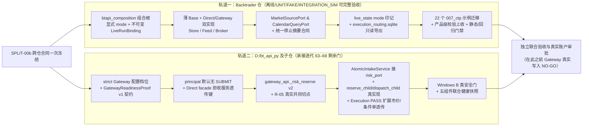
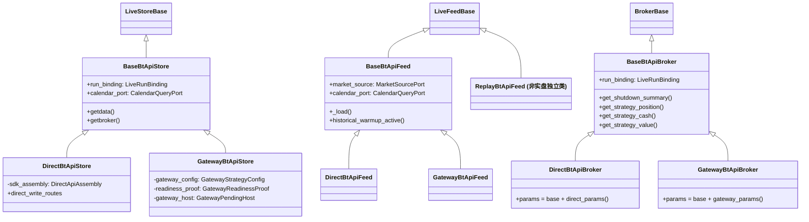
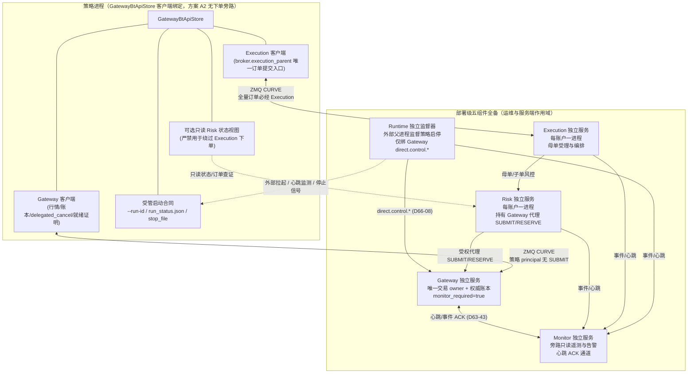
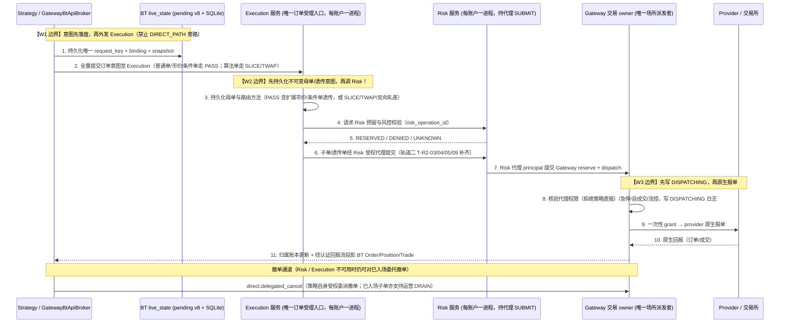

# 设计文档：Backtrader 实盘 Direct 与 Gateway 拆分（v2）

> 日期：2026-11-23　状态：**设计草案 / 门禁 G0 已闭合（2026-11-23 用户确认 `D62S-01`～`D62S-09`） / REVIEW_PENDING / 未实施**
> 上游与同套件文档：[需求文档 v3](需求文档.md)（含需求 `R62S-01`～`R62S-16` 与已确认决定 `D62S-01`～`D62S-09`） · [开发计划](开发计划.md) · [验收文档](验收文档.md)。历史 v1 与五份评审报告见 [old/](old/)。
> 证据基线：Backtrader `dev @ 575e9ddca`、`D:/bt_api_py dev @ 53d3ebe6`（全文 **STATIC** 设计，非交付现状；全部验证项 **NOT_RUN**）。本版已同步落账 2026-11-23 用户拍板的全部 9 项决定（含 `D62S-05` **方案 A2 全量经 Execution + 扩展 `PASS` 透传市价/条件单**、`D62S-08b` 公开 6 具体类 + 组合根工厂 + 兼容壳、`D62S-09` 单进程单模式与故障矩阵两处留白闭合）。

---

## 1. 总体架构与双轨解耦边界（对应 R62S-07、R62S-16）

为确保 Backtrader 单体拆分不被 SDK 侧外部数据与底层写路径阻塞（`_risk_reserve` v1 恒 UNKNOWN、`reserve_child/dispatch_child` 恒 UNKNOWN、`AtomicIntakeService` 无 `risk_port`、`R-05` 真实切点缺口），系统按“协议先行、双轨推进、联合合龙”组织：



**跨仓依赖红线（严格零违反）**：

- `backtrader/` 仅依赖 `bt_api_py` 公开中立契约与 `bt_api_base` 中立模型，**保持对 `bt_api_gateway`、`bt_api_risk`、`bt_api_execution`、`bt_api_monitor`、`bt_api_runtime`、`bt_api_transport_zmq` 零直接导入**；
- `bt_api_runtime/runtime/pyproject.toml` 反向依赖 `back-trader-python>=1.4.0`——Backtrader 若直接导入 `bt_api_runtime` 即构成循环依赖，因此 Runtime 监督合同只能通过受管 CLI 参数与 `backtrader/live_trading/` 状态文件交互，以及 Gateway 侧就绪证明字段体现。

---

## 2. 配置分层、显式 Mode 与组合根设计（对应 R62S-01、R62S-02、R62S-03）

### 2.1 显式 `mode` 与配置分层 Schema

策略级配置统一拆分为三层，由单一组合根在启动时一次性解析并冻结（具体 YAML 顶层键路径与 kwargs 形态在 `SPLIT-00b` `contracts/config_schema_v1.md` 定稿，以下为推荐形态）：

```yaml
# 1. 公共层（Direct 与 Gateway 共享，严禁出现模式专属键）
mode: direct              # 必填枚举：direct | gateway（启动时不可变）
symbols: [SA701]
contracts:
  SA701: {exchange: CZCE, price_tick: 1.0, multiplier: 20, quantity_unit: contracts, time_in_force: GFD}
broker:
  position_mode: net      # 启动时与 mode 一并冻结不可变
  market_data_only: false # 两模式均合法的只读预演开关（D62S-08）
feed: {timeframe: minutes, compression: 1, backfill_start: false, event_time_max_age: 2.0, receive_time_max_age: 2.0}
strategy_params: {...}
logging: {...}
trade_logger: {...}

# 2A. Direct 专属层（仅 mode: direct 允许存在）
direct:
  write_admission: true   # false 为 Direct 只读预演态
  market_clock_verification: true
ctp: {...}                # provider 公开参数（凭据仍经受保护 .env/环境变量注入，不入库）
calendars: {root: ../calendars, feed_scope: {...}}

# 2B. Gateway 专属层（仅 mode: gateway 允许存在）
gateway_resource_provider: local_files
gateway_strategy:
  schema_version: 1       # 或升级严格档位 schema（见 §6.3）
  exchange_name: CTP___FUTURE
  risk: {...}             # 必填，禁止 "none"（D62S-04）
  execution: {...}        # 必填，禁止 "none"（D62S-05）
  calendar_settings: {...}
  # Monitor 与 Runtime 就绪要求经 GatewayReadinessProof 校验（见 §6.2）
```

**现行隐式判据到显式 `mode` 的迁移投影表**：

| 现行隐式判据（源码实证） | 目标处理（SPLIT-01 起） |
| --- | --- |
| `"gateway_strategy" in config`（`btapistore.py:605`） | 必须配合显式 `mode: gateway`；缺 `mode` 直接拒绝（`MODE_REQUIRED`），错误指引提示添加 `mode: gateway` |
| `backend="direct"` + `write_admission` + `not has_execution`（`btapistore.py:735–756`） | 必须配合显式 `mode: direct`；`backend` 退为兼容校验（出现 `backend="gateway"/"forwarding"` 继续抛 `LegacyGatewayMigrationRequiredError`） |
| `api=ServiceReadProxy(...)`（`btapistore.py:712`） | 迁至独立非实盘入口（`ServiceReadOnlyStore` / `ServiceReadProxy` 专用适配器），不接受 `mode: direct\|gateway` |
| `provider="local_replay"`（`btapifeed.py:822–853`） | 迁至独立非实盘类 `ReplayBtApiFeed`（保持 `store=None` 门禁），不进入实盘组合根 |

### 2.2 两模式精确拒收键清单（与两仓源码逐键对齐）

- **Direct 模式拒收键（任何网络连接前 finite 拒绝）**：
  - Gateway/服务键：`gateway`、`gateway_strategy`、`gateway_resource_provider`、`gateway_host`、`gateway_security_profiles`、`gateway_run_lock`；
  - 混合执行路由键（路径 5）：`service_client_config`、`gateway_client_config`、`execution_parent_port`、`execution_order_routing`；
  - 62.08 服务透传键（路径 6，来自 `direct_api_assembly.py:103–115`）：`market_runtime_factory`、`forwarding_config`、`transport_mode`；
  - 旧直连 SDK 托管/本地 journal 键（路径 2/3，按 `D62S-07`）：`managed_execution_adapter`、`execution_authorization`、`settlement_authorization`、`execution_config` 及 `DIRECT_EXECUTION_CONFIG_KEYS`（`order_journal`、`require_order_journal`、`order_poll_interval`、`account_currency`、`account_currencies`、`account_ids`、`required_environments`、`strategy_id`、`strategy_identity_sha256`、`account_maximum_loss_bps`、`account_risk_max_age_seconds`；注：`market_data_only` 保留为显式只读预演参数，不列入拒收）；
  - 显式 `risk` 或顶层 `execution` 键（维持 `risk_requires_gateway`）。
- **Gateway 模式拒收键（任何网络连接前 finite 拒绝）**：
  - 直连/provider 键：`exchange_kwargs`、`direct`、`ctp`（及任何交易所原生直连凭据/前置配置）、`write_admission`、`api`、`api_cls`、`api_kwargs`、非空 `backend`（与 `btapistore.py:655–661, 758–761` 保持一致并收紧）；
  - 弱风控/弱执行键：`gateway_strategy.risk == "none"` 或缺失（`D62S-04`）、`gateway_strategy.execution == "none"` 或缺失（`D62S-05`）、顶层 `risk` / `execution`；
  - 日历混配键：本地 `calendars.feed_scope` 以及 `feed`/`contracts` 中的 `calendar_*` 字段（对齐 `gateway_client_runner.py:146–154`）；
  - 旧托管与混合路由键：`managed_execution_adapter`、`execution_authorization`、`settlement_authorization`、`execution_config`、`service_client_config`、`gateway_client_config`、`execution_parent_port`。
- **测试替身注入白名单（避免堵死 S-02/S-03 假场所测试）**：
  - 仅在受限内部工厂/关键字参数（如显式 `direct_api_factory` 或受控测试构造钩子）允许单元测试注入 fake unified facade / fake Gateway session；生产 YAML 配置解析器严格不接受外部可调用对象或自定义类名字符串（延续 `gateway_client_runner.py:251` 不导入 YAML 路径原则）。

### 2.3 单一组合根 `backtrader/stores/btapi_composition.py`

新增单一显式组合根模块（最终路径与导出名在 `SPLIT-00b` `contracts/public_api_v1.md` 定稿），职责为四步确定性流水线：

1. **配置快照与分层校验**：一次性拷贝不可变快照（防止惰性 `Mapping` 在校验与消费间变异，沿用 `btapistore.py:594–604` 纪律），执行显式 `mode` 检查与 §2.2 拒收矩阵；
2. **不可变运行绑定求值（`LiveRunBinding`）**：生成 `@dataclass(frozen=True)` 运行绑定对象，携带不可伪造 `binding_token`（`object()` 实例令牌）、`mode`（`"direct"` / `"gateway"`）、`position_mode`（`"net"` / `"dual_side"`）、`market_data_only`（`bool`）、`account_scope`、`strategy_scope`、`route`、`session_generation`；
3. **同模式整套装配与进程级单模式守卫（落实 `D62S-08b`、`D62S-09a`）**：
   - 公开导出 **6 个具体类**（`DirectBtApiStore/Feed/Broker`、`GatewayBtApiStore/Feed/Broker`）与显式组合根工厂，保留 `BtApiStore/Feed/Broker` 兼容壳至 SPLIT-04 迁移完成再按弃用期处置；
   - 组合根维护进程级模式栅栏：同一操作系统进程默认仅允许单一实盘模式（首次装配锁定进程模式，若同进程试图再装配另一模式立即 finite 拒绝 `PROCESS_MODE_CONFLICT`，确保模块零交叉加载）；
   - `mode == "direct"` → 创建 `DirectBtApiStore(binding=...)`，其 `getdata()` 返回 `DirectBtApiFeed`（注入 `DirectMarketSourcePort` + `LocalCalendarQueryPort`），`getbroker()` 返回 `DirectBtApiBroker`；
   - `mode == "gateway"` → 创建 `GatewayBtApiStore(binding=...)`（含 `GatewayReadinessProof` 校验挂点），其 `getdata()` 返回 `GatewayBtApiFeed`（注入 `GatewayMarketSourcePort` + `GatewayCalendarQueryPort`），`getbroker()` 返回 `GatewayBtApiBroker`；
4. **跨对象互挂守卫**：`Feed` 与 `Broker` 在构造与 `start()` 时验证 `store.run_binding is self.run_binding`（同一令牌、同一 mode、同一账户/策略/route/代次），任何跨模式、跨账户或跨代次互挂立即抛 finite 拒绝错误。

### 2.4 兼容壳与 `isinstance` 的数学严谨设计（修正 v2 OOP 错误）

> **修正说明**：旧版设计文档写“Base 是壳的基类，Direct/Gateway 继承 Base，因此 `isinstance(x, BtApiStore)` 为真”，这在 Python 继承模型中是**不成立的**（兄弟类之间 `isinstance` 为 `False`）。

为同时满足“薄 Base + 两套独立具体类”与“历史调用方 `isinstance(x, BtApiStore / BtApiFeed / BtApiBroker)` 保持为真”，采用以下数学严谨设计：

1. **推荐方案（受控抽象兼容基类 + `__new__` 工厂分发，或在 `Base` 上设 `ABC.register`）**：
   - `BaseBtApiStore(LiveStoreBase)` 为公共基类；
   - `DirectBtApiStore(BaseBtApiStore)` 与 `GatewayBtApiStore(BaseBtApiStore)` 为两套完全独立的子类，彼此无继承关系、不共享对方私有方法或参数；
   - 公开兼容壳 `BtApiStore` 保留在 `backtrader.stores.btapistore`：
     - **构造委托**：`BtApiStore.__new__(cls, ...)` 在直接调用 `BtApiStore(...)` 时委托 `btapi_composition.create_store(...)`，返回 `DirectBtApiStore` 或 `GatewayBtApiStore` 实例（若调用方显式子类化 `BtApiStore`，则走普通子类构造）；
     - **`isinstance` 兼容性**：将 `BtApiStore` 设为轻量兼容协议/虚拟父类（通过 `abc.ABC` + `BtApiStore.register(DirectBtApiStore)` / `BtApiStore.register(GatewayBtApiStore)`，或使 `DirectBtApiStore`/`GatewayBtApiStore` 继承 `BaseBtApiStore` 且 `BtApiStore` 作为公开别名基类——具体在 `SPLIT-00b` `T-012` 验证与 `ParameterizedBase` / `LiveFeedBase(ABCMeta)` 无元类冲突后二选一冻结），从而数学上严格保证 `isinstance(DirectBtApiStore(...), BtApiStore) is True` 与 `isinstance(GatewayBtApiStore(...), BtApiStore) is True`，且 `isinstance(direct_store, GatewayBtApiStore) is False`！
2. **全仓 7 处 `isinstance` 与 3 处非绑定类方法调用逐点改造表（2026-11-23 全仓实测）**：

| 源码位置 | 现行代码 | 目标改造方案 |
| --- | --- | --- |
| `backtrader/brokers/_btapi_gateway_stream.py:361` | `isinstance(source, BtApiFeed)` | 改为 `isinstance(source, BaseBtApiFeed)`（并进一步校验其 `run_binding.mode == "gateway"`） |
| `backtrader/brokers/_btapi_gateway_stream.py:365, 367` | 非绑定类方法调用 `BtApiFeed.historical_warmup_active(source)`、`BtApiFeed.gateway_trade_qualification(source, ...)` | 上提到 `BaseBtApiFeed` / `GatewayBtApiFeed` 明确定义的防覆写类方法或独立只读校验函数，避免因 `type(source)` 变为 `GatewayBtApiFeed` 引发绑定/MRO 异常 |
| `backtrader/feeds/btapifeed.py:1995, 2004` | `isinstance(store, BtApiStore)` 与非绑定类方法 `BtApiStore.gateway_instrument_status(store, ...)` | 改为 `isinstance(store, GatewayBtApiStore)` 与 `GatewayBtApiStore.gateway_instrument_status(store, ...)` |
| `backtrader/service/gateway_config.py:410` | `isinstance(data, BtApiFeed)` | 改为 `isinstance(data, GatewayBtApiFeed)`（或 `BaseBtApiFeed` + Gateway 绑定校验） |
| `backtrader/service/managed_runtime_host.py:374, 377` | `isinstance(broker, BtApiBroker)`、`isinstance(store, BtApiStore)` | 随路径 3 按 `D62S-07` / `D65-11` 在 SPLIT-04 一并退役 |
| `backtrader/service/service_execution_session.py:702` | `isinstance(broker, BtApiBroker)` | 随路径 3 按 `D62S-07` / `D65-11` 在 SPLIT-04 一并退役 |

---

## 3. 类结构、全量模块归属与构造机制约束（对应 R62S-07）

### 3.1 目标类层次与端口关系图



### 3.2 全量模块与 Mixin 归属矩阵（覆盖实盘 7 个目录）

| 目录 / 现有单元（行数） | 目标归属 | 拆分与清退动作说明 |
| --- | --- | --- |
| **Stores** | | |
| `stores/btapistore.py`（7,337 行） | 拆为 `BaseBtApiStore` + `DirectBtApiStore` + `GatewayBtApiStore` + 兼容壳 `BtApiStore` | `StoreManagedExecutionBridgeMixin` 随路径 3 退役（`D62S-07`）；`StoreReconciliationBridgeMixin` 入 `Base`（或 `Direct`，经 SPLIT-00a 核定）；`_configure_execution_routing`（路径 5）在 SPLIT-04 清退 |
| `stores/_btapi_errors.py`、`_bar_history_cache.py`、`_contract_metadata.py`、`_latest_tick_cache.py`、`_live_bar_queue.py`、`_market_delivery_state.py`、`_tick_stream_resync.py`、`_account_*.py`（11 文件） | `Base` / `Direct` 各自复用 | SPLIT-00a 逐文件确认仅 Direct 使用的模块（如 `_account_position_subscription.py`）下沉至 Direct，避免 Gateway 误加载 |
| **Feeds** | | |
| `feeds/btapifeed.py`（4,269 行） | 拆为 `BaseBtApiFeed` + `DirectBtApiFeed` / `GatewayBtApiFeed` + 独立 `ReplayBtApiFeed` + 兼容壳 `BtApiFeed` | `_load` 因果对、聚合与数据线留 `Base`；来源读写抽进 `MarketSourcePort`；日历抽进 `CalendarQueryPort` |
| `feeds/_btapi_cohort.py`、`market_factor_source.py` | Direct 或独立研究入口（路径 7，SPLIT-00b 冻结） | Gateway Feed 显式拒绝 cohort（维持 `btapifeed.py:1027–1029`） |
| `feeds/replay_market_adapter.py` | 独立非实盘 `ReplayBtApiFeed` | 彻底剥离出实盘 `BaseBtApiFeed` |
| **Brokers（`btapibroker.py` 6,675 行 + 12 私有模块 18,871 行）** | | |
| `brokers/btapibroker.py`（6,675 行） | `BaseBtApiBroker` + `DirectBtApiBroker` + `GatewayBtApiBroker` + 兼容壳 `BtApiBroker` | 移除旧路径 2/3 提交与撤单分支（`D62S-07`）；拆分 `submit`/`cancel`/`start`/`stop` 消除 82 处 `if _gateway_mode` 分支 |
| `_btapi_direct_mode.py`（6,363 行，`BtApiDirectModeMixin`） | **Direct 专属**（`DirectBtApiBroker`） | 保留迭代 62 Direct 写入、对账、待发单与停止逻辑；SPLIT-04 移除其中路径 5 路由钩子（L3228–3232, 3267–3295） |
| `_btapi_gateway_stream.py`（2,123 行，`GatewayExecutionStreamBrokerMixin`） | **Gateway 专属**（`GatewayBtApiBroker`） | 按 `D62S-01/04/05` 去除“无 Risk 直达 Gateway”死分支，接入就绪证明校验 |
| `_btapi_gateway_notifications.py`（1,360 行）、`_btapi_gateway_projection.py`（1,442 行）、`_btapi_gateway_events.py`（842 行） | **Gateway 专属**（`GatewayBtApiBroker`） | 保持 Gateway 框架对象快照、本地通知事务与事件流消费 |
| `_execution_parent_projection.py`（1,957 行）、`_execution_routing_apply.py`（829 行） | **Gateway 专属**（路径 4 保留，移除路径 5 Direct 侧调用） | **关键防误伤项**：原由路径 4 与路径 5 共用，SPLIT-04 清退路径 5 时必须完好保留给 Gateway 路径 |
| `_btapi_strategy_ledger.py`（318 行）、`_btapi_strategy_events.py`（1,478 行）、`_btapi_reconciliation.py`（510 行） | **Base（经共享状态清单对照证实后上提）** | 仅保留语义完全一致的框架投影逻辑；授权决策不沉入 Base |
| `_btapi_owner_fence.py`（261 行，`AccountOwnerFenceBrokerMixin`） | 按模式分别持有或随路径 2/3 评估（授权模型不进 Base） | SPLIT-00a 核实其现行调用方（若仅路径 2/3 使用则随 `D62S-07` 一并退役） |
| `_btapi_recovery.py`（1,388 行，`ServiceRecoveryBrokerMixin`） | **按 `D62S-07` / `D65-11` 在 SPLIT-04 退役** | 属旧托管恢复路径，不留在实盘双模式中 |
| **Service（23 文件）** | | |
| `service/gateway_config.py`（780 行）、`gateway_market_adapter.py`（1,163 行）、`gateway_instrument_status.py` | **Gateway 专属** | `gateway_config.py` 扩展就绪证明消费与 `mode` 校验，保留 `gateway_execution_routing.sqlite` 管理 |
| `service/store_lifecycle.py`（844 行）、`store_event_dispatch.py`、`store_event_notifier.py`、`bounded_metadata_probe.py`、`trading_calendar_config.py` | **Base / Direct 按需拆清** | 剥离其中旧托管与 `event_batch_handoff` 废弃分支 |
| `service/service_read_proxy.py`（673 行） | **独立非实盘只读入口（`D62S-08`）** | 保持对 `bt_api_runtime` 只读观测兼容（跨仓核对），从实盘 Store 中剥离 |
| `service/service_execution_session.py`（983 行）、`service_execution_adapter.py`（1,174 行）、`managed_runtime_host.py`（542 行）、`_service_execution_recovery.py`（737 行）、`_store_managed_bridge.py`（258 行） | **按 `D62S-07` / `D65-11` 在 SPLIT-04 退役** | 退役前在 SPLIT-00a 确认无残余生产调用方及历史状态迁移需求 |
| **live_state（19 文件）与 live_trading（5 文件）** | | |
| `live_state/identity.py`、`sequence.py`、`atomic.py`、`audit.py`、`state_dir.py`、`coordination.py`、`cli.py`、`_common.py` | **双模式公共持久层** | `identity.py` 扩展不可变 `mode` 字段；`cli.py` 新增旧混合库只读导出子命令 |
| `live_state/pending.py`（v1）、`waiting.py`、`waiting_notify.py`、`snapshot.py` | **Direct 专属持久层** | 维持 v1 schema 与休市待发单持久机制 |
| `live_state/gateway_pending.py`、`gateway_execution_state.py`、`gateway_order_state.py`、`gateway_execution_route.py`、`gateway_initialization.py` | **Gateway 专属持久层** | 维持 v5–v8 隔离及严格五组件版本核验 |
| `live_trading/run_status.py`（1,460 行）、`graceful_stop.py`、`stop_request_file.py`、`interface.py` | **双模式公共运行契约层** | 统一停止摘要直接对齐其 `OUTCOMES` 与 `EXIT_CODES`（0/1/2/3/4） |

### 3.3 Backtrader 真实构造机制安全守则（消除去元类化陷阱）

1. **Store 显式构造守则**：因 `StoreParams.__init__`（`store.py:45`）只读取 `getattr(self.__class__, "params", ())` 而**不沿 MRO 合并父类 `params`**，`BaseBtApiStore`、`DirectBtApiStore`、`GatewayBtApiStore` **一律不定义类属性 `params`**，全部沿用显式 `__init__` 关键字形参并通过 `super().__init__(...)` 传递公共运行绑定。
2. **Broker 描述符参数隔离守则**：`BrokerBase(BrokerAliasMixin, ParameterizedBase)` 通过描述符合并 `params`。`BaseBtApiBroker` 仅声明两模式共享参数（`store`、`cash`、`value`、`position_mode`、`market_data_only`、`shutdown_timeout` 等）；`DirectBtApiBroker` 独立拼接 `params = BaseBtApiBroker.params + direct_params()`（含 `strategy_dir`、`first_init`、`waiting_orders`、`direct_facts_timeout`、`direct_permission_check`、`direct_stop_write_timeout` 等）；`GatewayBtApiBroker` 独立定义 Gateway 专属参数，**彻底杜绝 Direct 参数暴露给 Gateway**。
3. **Broker 共享状态清单入口条件（SPLIT-03a 硬前置）**：在移动任何 Mixin 之前，`T-007` 必须产出《Broker 共享状态表（字段 × 读写方 × 模式）》，逐项审计 `self.orders`、`self.notifs`、`self.positions` / `long_positions` / `short_positions`、`_trading_enabled`、`_startup_ready`、`_live_started`、`order.info`（Direct 字段 vs `gateway_*` 字段）以及 `super()` 委派链，确保两模式对同名状态字段无语义冲突。
4. **Feed 与 Strategy 兼容守则**：`BaseBtApiFeed` 继承 `LiveFeedBase(DataBase, ABC)`，保留 `ParamsMixin.__init_subclass__` / `patched_init` / `donew → doinit → dopostinit` 生命周期及 `self.p`/`self.params` 别名；不破坏用户 `bt.Strategy` 直接子类不调用 `super().__init__()` 的例外。

---

## 4. 端口抽象与框架语义对齐（对应 R62S-08、R62S-09、R62S-10）

### 4.1 `MarketSourcePort` 与 Feed 能力矩阵

`BaseBtApiFeed` 不再判断 `getattr(store, "_gateway_strategy_config", None)` 或 `self.__dict__.get("_gateway_market_adapter")`，而是统一面向抽象协议 `MarketSourcePort` 编程：

| 端口方法 / 能力维度 | `DirectMarketSourcePort` | `GatewayMarketSourcePort`（封装 `GatewayMarketAdapter`） |
| --- | --- | --- |
| `validate_feed_options(feed)` | 允许 `backfill_start`、`historical_bars`、`live_bars`、`orderbook_as_ticks`（按 SDK 规则）及路径 7 cohort（若归 Direct） | **显式拒绝** `backfill_start`、`historical_bars`、`live_bars`、`cohort_source_mode`、`orderbook_as_ticks`（保留 `GATEWAY_MARKET_FEED_CONFIGURATION_UNSUPPORTED`） |
| `start()` / `stop()` | 绑定 `DirectBtApiStore` SDK `market_stream_session` 订阅 | 启动独立 `GatewayMarketAdapter` 订阅（不绑 Store 轮询） |
| `drain_ticks()` / `drain_orderbooks()` / `poll_live_bar()` | 经 `DirectBtApiStore` 队列与事件消费 | 经 `GatewayMarketAdapter` 消费（`poll_live_bar` 返回 `None`） |
| `idle_wait(qcheck, drained)` | `qcheck > 0` 休眠或 `StoreEventNotifier` 唤醒 | `qcheck > 0` 按 `qcheck`，否则按 **`_GATEWAY_IDLE_POLL_SECONDS`** 退避（保留 2026-11-10 SimNow 实测防忙轮询占核修复，`btapifeed.py:2552–2559`） |
| `recovery_reason()` | `store.tick_stream_recovery_reason` | `adapter.recovery_reason` |
| `trade_qualification()` | SDK `market_clock_verification`（SNTP + 场所时间核对） | Gateway 侧时钟资格与 `dispatch_market_ref`（含 `key/epoch/sequence/message_id`） |
| `_load()` 因果对与 bar 聚合 | **由 `BaseBtApiFeed` 统一实现**：先投递待发 `self._live` 完成 bar 再排空新 tick，确保完成 bar 回调与数据线推进成对一致 | 与 Direct 共享同一 `BaseBtApiFeed._load()` 实现；parity 测试覆盖两者能力交集并显式声明不支持项 |

### 4.2 `CalendarQueryPort`（隔离迭代 67 两种只读日历来源）

- **`LocalCalendarQueryPort`（Direct）**：绑定 `DirectBtApiStore` 的本地只读版本化日历目录（`calendars.root` + `calendars.feed_scope`），标明 `SYNTHETIC_MOCK` 种子与真实发布目录来源差异（`D67-01`）；
- **`GatewayCalendarQueryPort`（Gateway）**：仅使用 `GatewayStrategyConfig.calendar_settings` 经 Gateway 网络查询；组合根与 Feed 启动时**强制拒绝混配本地 `calendars.feed_scope` 或 `feed/contracts` 中的 `calendar_*` 字段**（`CALENDAR_SCOPE_CONFLICT`）；
- 两端口对外返回完全一致的只读交易时段与交易日对象（缺失或未发布一律显式返回 `UNKNOWN` / `CALENDAR_SCOPE_UNAVAILABLE`，严禁猜测）。

### 4.3 统一停止摘要合同（对齐 `live_trading/run_status.py`）

将原本散落在 `examples/live/007_ctp/gateway_client_runner.py:43–88` 中的私有翻译函数 `contract_broker_summary()` 正式上收为 `BaseBtApiBroker.get_shutdown_summary()` 的统一产品合同，直接输出 `backtrader/live_trading/run_status.py` 冻结的 `OUTCOMES` 词汇与退出码：

| 统一 `status`（`run_status.py:134–160`） | 进程退出码 | Direct 模式来源状态（`_btapi_direct_mode.py:6044–6059`） | Gateway 模式来源状态映射（取代 `contract_broker_summary`） |
| --- | :---: | --- | --- |
| `STOPPED` | `0` | 停止完成且 `unresolved == 0` 且无在途写 | `gateway_status == "PASS"` 且 `unresolved_working_orders == 0`；**或** `market_data_only is True` 且 `gateway_status == "OBSERVATION_ONLY"` 且 `unresolved == 0` 且 `active_order_count == 0` |
| `STOPPED_WITH_WORKING_ORDERS` | `3` | 停止完成但存在 `unresolved > 0` 活动挂单 | `unresolved_working_orders` 为正整数（`> 0`） |
| `STOPPED_WITH_WRITE_IN_FLIGHT` | `4` | 停止等待超时仍有已提交在途写（锁保留） | Gateway 存在未确认完成/在途清理或未决派发（具体字段在 SPLIT-03a 冻结） |
| `BLOCKED` | `2` | 启动前置阻断或未授权退出 | 就绪证明/预检失败阻断退出 |
| `UNKNOWN` | `1` | 其余任何未证实或异常中断状态（fail-closed） | `INCOMPLETE` / `FAIL` / 缺失 `unresolved` 计数或任意未覆覆盖组合（绝不退化为 `0`） |

附加字段保留 `mode`、`gateway_status`（Gateway 模式透出原始会话状态以利诊断）、`unresolved_working_orders`、`market_data_only`、`active_order_count`。

### 4.4 `waiting_orders` 与策略三查询接口的差异合同

- **`waiting_orders`（休市跨时段待发单，`D62-30/31`）**：明确为 **`DirectBtApiBroker` 专属能力**；`GatewayBtApiBroker` 不暴露 `waiting_orders` 参数，继续按现行合同（`_btapi_gateway_stream.py:564–568`、`D65-03`）拒绝非 `Order.Limit` 与非空 `Order.valid`（直到迭代 65 另行冻结母单期限配置）。
- **策略三查询接口（`get_strategy_position` / `get_strategy_cash` / `get_strategy_value`，对齐 `D63-41/44`）**：
  - `GatewayBtApiBroker`：绑定当前策略流后，经 Gateway 权威归属账本与 `GatewayBtApi.get_strategy_financial(...)` 读取（保留精确十进制校验、1.0 s 新鲜度与显式币种检查，`btapibroker.py:2213–2271`）；
  - `DirectBtApiBroker`：单策略独占账户（`D62-05`），在 SPLIT-03b 明确冻结——`get_strategy_position` 返回绑定策略单腿/净持仓视图，`get_strategy_cash`/`get_strategy_value` 若未配置显式策略预算则按 `D63-41` 明确返回不可用（绝不静默借用旧 `StrategyLedgerBrokerMixin` 或把账户总额伪装为策略预算）。

---

## 5. `live_state` 持久状态层与存量迁移设计（对应 R62S-11、R62S-12）

### 5.1 策略目录 `<strategy_dir>/state/` 文件归属布局

| 文件路径 | 所属层 | Direct 模式使用 | Gateway 模式使用 | 隔离 / 清退规则 |
| --- | --- | --- | --- | --- |
| `state/identity.json`（+ `identity.lock`） | 公共层 | 读写 | 读写 | **新增不可变 `mode` 字段**（§5.2），彻底阻止跨模式共用同一目录 |
| `state/sequence.json` | 公共层 | 读写 | 读写 | 按策略 UUID 维护 `local_seq` 与 `ref_high_water` |
| `state/run.lock`、`run_status.json`、`last_run.json` | 公共层 | 读写 | 读写 | 与 `live_trading/run_status.py` 和 Runtime 监督契约对齐 |
| `state/audit.jsonl` | 公共层 | 追加 | 追加 | 只追加审计日志，含 `mode` 标签 |
| `state/pending.json` | **模式隔离** | **`version = 1`**（`live_state/pending.py`） | **`version = 5/6/7/8`**（`live_state/gateway_pending.py`） | 两套 schema 互不解读；v5–v7 在五组件新契约下须经离线核验后显式升级或空仓迁移 |
| `state/waiting_orders.json`、`logs/current_position.yaml` | **Direct 专属** | 读写 | **禁止存在/读取** | Gateway 目录若发现残留 Direct 待发单文件，启动期 fail-closed |
| **`state/gateway_execution_routing.sqlite`** | **Gateway 专属（路径 4）** | **禁止打开** | 读写（`service/gateway_config.py:21, 98`） | 完整保留给 `GatewayBtApiStore`（`O_NOFOLLOW` + 所有者/dev-ino 校验维持） |
| **`state/execution_routing.sqlite`** | **废弃混合路由（路径 5）** | **SPLIT-04 起禁止新建/写入** | **禁止打开** | 仅通过只读导出 CLI 读取并写审计报告（§5.4），**严禁删库** |

### 5.2 `state/identity.json` 不可变 `mode` 印记设计

- 现行 `backtrader/live_state/identity.py:68–74` 为 `IDENTITY_VERSION = 1`，键集仅含 `{version, strategy_uuid, created_at_utc, hostname, strategy_dir, account_binding}`，无 `mode` 字段。
- **目标扩展（`IDENTITY_VERSION = 2` 或向后兼容可选迁移）**：
  - 新初始化的策略目录必须在 `--first-init` 时显式声明 `mode: "direct" | "gateway"` 并永久写入 `identity.json`（受 `O_CREAT | O_EXCL` 与 `identity.lock` 保护）；
  - 启动时 `DirectBtApiStore` 要求 `identity.mode == "direct"`，`GatewayBtApiStore` 要求 `identity.mode == "gateway"`，任何不匹配立即抛 `LiveStateModeMismatch`（`EXIT_BLOCKED = 2`）；
  - **历史 `IDENTITY_VERSION = 1`（无 `mode` 字段）目录处理**：不得静默猜测写入 `mode`！提供显式只读检查与离线迁移子命令（依据 `pending.json` 版本 1 vs 5–8 + 是否存在 `waiting_orders.json` / `gateway_execution_routing.sqlite` + 空仓/零未决核验结果，经操作者确认后原子升级写入 `mode` 并记入 `audit.jsonl`）；存在冲突或未决记录时 fail-closed 拒绝升级。

### 5.3 历史 Gateway `pending.json v5–v7` 升级与 `D63-12` 空仓迁移

- 现行 Gateway `pending.json` 存在 v5（基础 Gateway）、v6（本地通知）、v7（Risk 委托）、v8（Execution 路由，见 `service/gateway_config.py:261–268, 342–357`）。
- 在严格五组件 Gateway 契约下，历史 `v5–v7` 目录缺少完整的 Risk/Execution 路由绑定：
  - 若目录存在任何活动委托、未决/UNKNOWN 记录或持仓，禁止以五组件新契约直接启动写入，只能先按原路径只读核验与对账清零；
  - 确认空仓且零未决后（`D63-12`），方可执行显式目录升级（升至包含 `mode: "gateway"` 与完整五组件绑定的目标版本）或初始化新策略目录。

### 5.4 旧混合路由库 `state/execution_routing.sqlite` 只读导出与清退（修正文件名）

- 明确区分两个不同文件：
  - 路径 5 旧混合库：**`state/execution_routing.sqlite`**（`btapistore.py:138, 1348`）；
  - 路径 4 Gateway 现行库：**`state/gateway_execution_routing.sqlite`**（`service/gateway_config.py:21, 98`）。
- SPLIT-04 清退路径 5 时：
  1. 在 `backtrader/live_state/cli.py` 新增只读子命令 `export-legacy-execution-routing --strategy-dir <dir> --out <json>`：以 SQLite 只读 URI（`file:...?mode=ro`）打开 `state/execution_routing.sqlite`，导出全部路由表、意图身份、绑定范围、状态（含 `PENDING`/`EXECUTION_PARENT`/`UNKNOWN`）、SHA-256 摘要，并向 `audit.jsonl` 追加只读导出审计记录；
  2. 任何启动路径检测到策略目录仍存在含未决记录的 `state/execution_routing.sqlite` 且未附带已审批清退标记时，启动期 fail-closed 拒绝写入；
  3. **严禁删除或修改原 SQLite 文件，严禁碰触 `state/gateway_execution_routing.sqlite`**。

---

## 6. Gateway 五组件部署与策略进程接线设计（对应 R62S-05、R62S-06）

### 6.1 两层接线模型（部署级全备 vs 策略进程绑定）



### 6.2 Gateway 就绪证明快照（`GatewayReadinessProof v1`）

Backtrader 策略进程**不直接连接 Monitor 或 Runtime 的 RPC 端口**，而是通过 SDK 中立只读接口向 Gateway 拉取带代次的 **`GatewayReadinessProof v1`** 快照（在 SPLIT-00b 冻结为跨仓中立 DTO，归属 `bt_api_base` / `bt_api_py`，BT 仅做消费与强校验）：

| 字段组 | 必填字段（SPLIT-00b 冻结精确类型） | 校验规则（fail-closed） |
| --- | --- | --- |
| 证明信封 | `schema_version`、`proof_generation`、`issued_at_ns`、`expires_at_ns`、`gateway_identity`（`service_id/instance_id/scope_ref`）、`account_scope`、`strategy_scope`、`route` | 须来自受认证 Gateway peer；与当前 `LiveRunBinding` 精确一致；未过期 |
| 权限不变量证明 | `strategy_principal_has_submit: false`、`strategy_principal_has_reserve: false`、`delegated_cancel_enabled: true` | 若任一不满足（例如策略 principal 仍持 `SUBMIT`），拒绝启动写入（`GATEWAY_PRINCIPAL_BYPASS_UNSAFE`） |
| Risk 绑定证明 | `risk_required: true`、`risk_service_ref`、`risk_protocol_version`、`risk_state`（`READY/DEGRADED/UNAVAILABLE/INCOMPATIBLE`） | 非 `READY` 则按故障矩阵处理（启动期拒绝写入，不可将 `UNAVAILABLE` 伪装为 `INCOMPATIBLE`） |
| Execution 绑定证明 | `execution_required: true`、`execution_service_ref`、`execution_protocol_version`、`execution_state` | 同上，且 `instance_id` 须与策略配置 `execution.routing.component` 一致 |
| Monitor 证明 | `monitor_required: true`、`monitor_service_ref`、`monitor_protocol_version`、`last_acked_heartbeat_age_ms`、`monitor_stop_new_active` | 若 `monitor_required` 非 `true` 或协议确认不兼容，拒绝启动；若运行期心跳超龄触发 `monitor_stop_new_active`，BT 仅展示与遵循 Gateway `STOP_NEW` |
| Runtime 监督声明 | `runtime_supervision_expected: true`、`runtime_service_ref`、`registered_run_id` | 与策略进程受管启动传入的 `--run-id` 精确匹配（缺失或不匹配 → 拒绝以受管实盘写入启动） |

**错误分类红线**：预检必须严格区分 ① `UNREACHABLE`（网络/超时）、② `AUTH_FAILED`（CURVE/主体鉴权失败）、③ `VERSION_INCOMPATIBLE`（已确认旧版协议不兼容，启动硬拒，对齐 `D68-02`）、④ `COMPONENT_NOT_READY`（组件已连但未就绪或缺少必要配置），绝不互相伪装。

### 6.3 服务端防绕过与 SDK 配置载体三选一裁决（SPLIT-00b 输入）

针对 `gateway_strategy_config.py` 与 `service_config.py` 分离的现状，SPLIT-00b（`T-010`）须从以下三案中**唯一裁定其一**（不得多套并存）：

1. **推荐方案 C（SDK `GatewayStrategyConfig` 严格档位 + Gateway 签发 `GatewayReadinessProof`）**：在 `bt_api_py/gateway_strategy_config.py` 新增显式严格模式入口 `parse_gateway_strategy_config(raw, *, profile="strict_five_component")`（保留既有 `profile="legacy_optional"` 以不破坏 SDK 其他调用方）；严格档位强制 `risk != "none"`、`execution != "none"` 并新增 `readiness_expectations` 声明（要求五组件就绪证明与 `runtime_supervision_expected=true`）；Gateway 服务端账户配置默认撤除策略 principal `SUBMIT/RESERVE`（`D62S-03`）。
2. **备选方案 A**：每策略配置引用部署清单 `service_config` 副本（按 `service_id/instance_id/scope_ref` 离线比对）——缺点是策略目录需同步部署清单副本，易漂移。
3. **备选方案 B**：仅在 BT 侧建只读预检适配器解析 `service_config`——缺点是校验滞留在 BT 层，无法复用于非 BT SDK 策略客户端。

**策略进程零 Direct 写客户端可检验定义**：`GatewayBtApiStore` 启动完成及 `S-03` 验收时，执行模块探测（参考迭代 63 `C-7`），断言 `sys.modules` 中未加载任何 provider 原生交易写入模块（如 `bt_api_ctp.direct_write_provider`、CTP TD native 封装），且 `GatewayBtApiStore` 不持有 `DirectApiAssembly` 或任何直连 TD 会话。

### 6.4 Runtime 外部监督契约（维持 D66-02）

- 策略进程由外部 `bt_api_runtime` 拉起，遵守既有 CLI 与文件契约：`--run-id <UUID>`、`--heartbeat-interval <seconds>`、`--stop-request-file <path>`、`state/run_status.json`、`state/last_run.json` 与 `EXIT_CODES`（0/1/2/3/4）；
- `GatewayBtApiStore` 通过验证受管启动参数与 `GatewayReadinessProof.registered_run_id` 一致来证明“本进程受 Runtime 监督”，不在进程内新建面向 Runtime 的 RPC 通道。

---

## 7. Gateway 订单链路拓扑与 W1/W2/W3 持久化故障窗口（对应 R62S-04、R62S-13）

### 7.1 已确认方案（D62S-01 方案 A + D62S-05 方案 A2：全量经 Execution → Risk → Gateway，无旁路）



> **核心闭环约束（2026-11-23 拍板生效）**：严格 Gateway 模式下 **100% 废止 `ExecutionOrderRouter` 的 `DIRECT_PATH` 未命中直通旁路**（`D62S-05` 方案 A2）与“无 Risk 直达 Gateway”死分支（`D62S-04`），且策略进程不设绕过 Execution 直连 Risk 的下单/应急平仓旁路（`D62S-09b`）；Gateway 服务端撤除策略 principal 的 `SUBMIT`/`RESERVE` 权限（`D62S-03`），仅由 Risk 代理 principal 向 Gateway 报单。轨道二新增 `T-R2-09` 为 Execution `PASS` 扩展市价/条件单透传支持（扩展 `D65-07`）。

### 7.2 方案 B（已否决备选：凭证/证据模型）历史对比留存

用户已于 2026-11-23 明确选择方案 A（代理转发链）+ 方案 A2（全量经 Execution），以下保留对比表仅作决策依据归档：

| 对比维度 | 已确认：方案 A + A2（代理转发链 + 全量经 Execution） | 已否决：方案 B（凭证/证据模型） |
| --- | --- | --- |
| 与 `D64-02` 兼容性 | **完全兼容**，复用现有 `RiskServiceClient` 与 `direct.delegated_*` | **推翻 `D64-02`**，需废弃 SDK delegated 路径并迁移 `pending.json v7` |
| Gateway 信任与防绕过 | Gateway 仅认 Risk 代理 principal，不查风控凭证，维持 `D63-17` | 需赋予 Execution 成为 Risk 凭证权威验证者的新授权，或让 Gateway 验 Risk 签名票据（推翻 `D63-17`） |
| 普通限价/市价/条件单支持 | 全量进 Execution，普通单走 `PASS` 并在轨道二（`T-R2-09`）扩展市价/条件单透传 | 需同步重写 Risk 凭证签发/核销/TTL 回收、Execution 验票与撤单代理合同 |
| 轨道二改造量 | 集中于既有剩余门（`_risk_reserve` v2、`AtomicIntakeService`、child dispatch、`R-05`）+ `PASS` 透传扩展 | 除上述全部外，另需推翻重做整套 delegated 与凭证合同 |

### 7.3 W1 / W2 / W3 持久化故障窗口状态机（修正次序）

| 窗口 | 边界与严格落盘次序 | 故障场景 | 强制安全行为（不变量） | 恢复 / 对账与释放路径 |
| --- | --- | --- | --- | --- |
| **W1** | `BT ↔ Execution/Risk`：先落盘 `live_state`（`pending.json` + 路由表），再外发 RPC | 请求发出后回复丢失、超时或策略进程崩溃 | 状态置 `EXECUTION_RECOVERY_PENDING` / `SUBMIT_UNKNOWN`；**阻断同合约后续下单**（`_btapi_gateway_stream.py:660–680`）；绝不重发新 `request_key` | 重启后以原 `request_key` 查询 Execution 母单状态 / Risk `risk.order.status` / Gateway `delegated_command_status`；`NOT_FOUND` 不直接判失败，须满足缺失终结窗口或对账证据 |
| **W2** | `Execution ↔ Risk`：**必须先持久化不可变母单到 Execution 日志**，再调 Risk `reserve`（遵守 `bt_api_execution/README.md:54–56`） | 母单已落盘，Risk 已预留额度，但回执未落盘到 Execution 或 Execution 崩溃 | 母单保持未确认预留态，**不得派发子单**，不得静默丢失母单记录 | Execution 恢复后携带原 `risk_operation_id` / `parent_ref` 向 Risk 查证预留状态，按结果决定继续编排或发起幂等释放，防止风控额度泄漏 |
| **W3** | `Risk/Gateway ↔ Provider`：先落盘 `DISPATCHING` 标记（Gateway journal / Risk claim），再获取一次性 grant 调原生报单 | 原生调用超时、网络中断或进程崩溃，provider 可能已受理而 ACK 未落盘 | 永久标为 `UNKNOWN`，阻断相关账户/合约写入；**绝不转标 `Rejected`、不自动释放预留、不切换 Direct** | 仅沿原路径以强原生身份（`OrderRef`/`FrontID`/`SessionID`/`ExchangeID`/`OrderSysID`）对当日全量订单/成交查询对账，或经受审计运营确认后推进终态 |

---

## 8. 单写者作用域与并发栅栏设计（对应 R62S-13）

| 层级 | 唯一写者作用域 | 现行与目标机制 | 明确边界与残余风险 |
| --- | --- | --- | --- |
| **Direct 策略进程** | 单策略目录（`D62-05` 单策略独占账户） | 本地文件锁 `state/run.lock`（校验 PID / 主机 / 目录身份） | 仅防本目录双启；**不防**同账户在其他目录、其他主机或手工终端登录（操作层残余风险） |
| **Gateway 账户 owner** | `账户 × 场所 × route`（`D63-02/08`） | 每账户一独立 Gateway 进程；同主机 SQLite lease + `HostAccountRegistry`；跨主机互斥以 SDK `bt_api_py.account_writer_authority` TTL 租约为候选（SPLIT-00b 选型冻结） | 同库 SQLite lease 仅约束本机协作进程（`bt_api_gateway/README.md`）；**跨主机与外部手工写者列为已知残余边界**，不以 fake 测试冒充全局防线 |
| **Gateway 策略写者** | `账户 × 策略`（2026-11-14 禁双活决定） | Gateway 服务端策略租约（单调代次）+ 策略目录本地 `state/run.lock` | 旧代次策略进程的 submit/cancel/ACK 请求一律被 Gateway 拒绝；多策略共享同一账户级 Gateway 交易 owner，绝不退化为每策略一个 TD writer |
| **Execution 服务** | `账户`（`D65-13`） | 每账户一独立 Execution 进程 + 本地持久 journal 锁 | 依赖账户级部署隔离，不自行建立场所写会话 |

---

## 9. 运行期五组件故障域 × 动作矩阵（对应 R62S-14，2026-11-23 已全部拍板闭合）

结合迭代 63–68 既有安全基线及 2026-11-23 用户对 `D62S-05` / `D62S-09b` / `D62S-09c` 的拍板，以下 5 行矩阵已**全部冻结无留白**：

| 故障组件 | 新开仓 | 平仓 / 减仓 | 撤单 | 策略进程行为 | 决策与合同依据 |
| --- | --- | --- | --- | --- | --- |
| **Gateway 不可用 / 断连** | 拒绝（fail-closed） | 拒绝（无法达场所） | 不可用（走外部应急规程） | 保持运行等待重连与对账（`D63-03`），**严禁回退 Direct**，不覆盖旧订单状态 | `D63-03`、`INV63-05` |
| **Risk 不可用 / 失联** | 拒绝（`RISK_UNAVAILABLE`） | **拒绝**（不绕过 Risk） | **放行**（策略经 Gateway `direct.delegated_cancel` 撤单） | 保持运行等待 Risk 恢复，不切无 Risk 直达 | `D64-02`、`D62S-04`、分析 `S-05a` |
| **Execution 不可用 / 崩溃** | **拒绝**（全量必经 Execution，不设旁路、不回 Direct） | **拒绝（fail-closed，已确认 `D62S-09b`）**：不设绕过 Execution 的应急平仓旁路，避免母单/账本漂移（紧急平仓走运营应急规程） | **放行已入场委托撤单**（按原归属/运营 DRAIN 或策略 `direct.delegated_cancel`）；母单冻结转恢复 | 保持运行，相关母单标 `EXECUTION_RECOVERY_PENDING`；恢复后按 `D65-05` 核对 | `D65-05`、`D62S-05`（方案 A2）、`D62S-09b` |
| **Monitor 中断 / 心跳超龄** | **拒绝**（由 Gateway 依据 `monitor_required=true` 自主施加账户级 `STOP_NEW`） | 正常放行（经 Execution/Risk 与账本） | **放行** | 策略进程不强杀；Monitor 恢复后按 `D63-33/Q34` 默认自动解除该原因（保留其他原因与 UNKNOWN） | `D63-36`、`D63-43`、`D68-02`、`D62S-02` |
| **Runtime 控制失联** | **已运行策略照常（已确认 `D62S-09c`）**：不因 Runtime 失联阻断新开仓 | **放行** | **放行** | 已运行策略不被强杀；无法经 Runtime 启停或代理 `RESUME`，急停仍可直连 Gateway 运营端口 | `D66-02`、`D66-08`、`D62S-09c` |

---

## 10. 九路径清退、22 个 `007_ctp` 示例迁移与产品级校验上收（对应 R62S-12、R62S-15）

### 10.1 产品级配置校验上收（消除示例层双轨漂移）

经实测，`examples/live/007_ctp/gateway_client_runner.py`（564 行）中 `L98–191` 存在近 100 行产品级配置校验，且 11 个 `*_direct/run.py` 各自复制了一份 Direct 配置校验逻辑。SPLIT-04 必须将其系统上收至 `backtrader/stores/btapi_composition.py`（与 SDK 严格配置解析协同）：

- 上收项清单：`LEGACY_CONFIG_UNSUPPORTED` 关键字拦截、`RISK_SELECTION_INVALID` / `GATEWAY_TOP_LEVEL_EXECUTION_UNSUPPORTED`、`symbols` 与 `contracts` / `instruments_by_ref` 对齐、`quantity_unit`/`time_in_force`/`price_tick`/`multiplier` 合约规则合法性、行情订阅 `require_source_descriptor` 绑定、日历 `CALENDAR_SCOPE_CONFLICT` 与 `gateway_calendar_scopes` 校验、Feed 鲜度/时钟配置校验、以及 `contract_broker_summary()`（上收为 `BaseBtApiBroker.get_shutdown_summary()`）；
- 上收后，`gateway_client_runner.py` 与各示例 `run.py` 仅保留 CLI 参数解析、日志配置、受保护资源注入和 `Cerebro` 启动组装（目标保持薄壳，不再复制任何业务规则判断）。

### 10.2 22 个 `examples/live/007_ctp/` 示例迁移清单

`examples/live/007_ctp/` 实测包含 **22 个策略目录**（`11 *_direct` + `11 *_gateway`：`bbroker_5s_*` 4 个、`mixbroker_*` 8 个、`sa_dual_ma_*` 2 个、`tickbroker_*` 8 个）+ `calendars/` + 5 个共享脚本：

- **11 个 `*_direct/config.yaml`**：顶层新增 `mode: direct`，保持 `direct.write_admission`、`calendars.feed_scope` 与 `ctp.*` 公开模板字段，验证不含任何 Gateway/服务键；
- **11 个 `*_gateway/config.yaml`**：顶层新增 `mode: gateway`，升级 `gateway_strategy` 符合严格五组件声明（`risk` 与 `execution` 均非 `"none"` + 就绪证明期望声明），继续禁止 `calendars.feed_scope`；
- **Runtime 监督契约回归**：全部 22 个示例的 `run.py` 保持与迭代 66 Runtime 监督器绑定的 `--run-id`、`--heartbeat-interval`、`--stop-request-file`、`state/run_status.json`、`state/last_run.json` 与 `EXIT_CODES`（0/1/2/3/4）完全兼容。

---

## 11. 跨仓依赖、版本矩阵、提交顺序与质量门禁（对应 R62S-16）

### 11.1 跨仓版本与 Python 要求矩阵（2026-11-23 `pyproject.toml` / `setup.py` 实测）

| 包 / 仓库 | 源码路径 | 当前源码版本 | `requires-python` | 关键依赖与备注 |
| --- | --- | --- | --- | --- |
| `backtrader` | `d:/source_code/backtrader` | `setup.py`（`dev @ 575e9ddca`） | `>=3.8` | CI push 跑 `3.8–3.13 × {ubuntu, macos, windows}`（18 cells），PR 跑 `3.11 / ubuntu`；`mypy` 目标 `python_version = "3.8"`；NumPy `<2.0`（`<3.13`）与 `>=2.1`（`>=3.13`）；`live` extra 现写 `bt-api-py>=0.15.5`，SPLIT-04 改可复现 pin |
| `bt_api_py` | `D:/bt_api_py` | `0.16.0.dev64` | `>=3.11` | 发布阻塞 CI `3.11–3.13`（`3.14` canary）；当前工作树 109 dirty |
| `bt_api_base` | `D:/bt_api_py/bt_api/bt_api_base` | `0.16.0.dev64` | `>=3.9` | 共享 DTO 与中立协议（`GatewayReadinessProof` 合同拟放置于此） |
| `bt_api_gateway` | `D:/bt_api_py/bt_api/bt_api_gateway` | `0.2.0.dev64` | **`>=3.10`** | 子模块当前 `+90760681`（偏离父仓 gitlink） |
| `bt_api_execution` | `D:/bt_api_py/bt_api/bt_api_execution` | `0.2.0` | **`>=3.11`** | 独立执行服务；`AtomicIntakeService` 与母单日志归属此仓 |
| `bt_api_risk` | `D:/bt_api_py/bt_api/bt_api_risk` | `0.1.1.dev64` | `>=3.9` | 独立风控服务；默认 `R-05` 仍缺切点 |
| `bt_api_monitor` | `D:/bt_api_py/bt_api/bt_api_monitor` | `0.1.1.dev64` | `>=3.9` | 旁路遥测与告警服务 |
| `bt_api_runtime` | `D:/bt_api_py/bt_api/bt_api_runtime/runtime` | **`0.1.18`** | `>=3.9` | **反向依赖 `back-trader-python>=1.4.0`**（严禁 BT 导入形成循环依赖） |
| `bt_api_transport_zmq` | `D:/bt_api_py/bt_api/bt_api_transport_zmq` | `0.1.0` | `>=3.9` | 默认传输包（`D63-50`）；子模块当前 `+5961b64d`（偏离父仓 gitlink） |
| `bt_api_ctp` | `D:/bt_api_py/bt_api/bt_api_ctp` | `2.1.0.dev64` | `>=3.9` | 首期 Gateway 与 Direct 核心期货 provider |

> **语法兼容约束**：Backtrader 新增拆分代码必须兼容 Python `3.8`（满足 `mypy python_version = "3.8"` 与 CPython 3.8 核心兼容测试，不得裸用 Python 3.10+ 联合类型语法而不加 `from __future__ import annotations`，且保持对可选 SDK 导入的延迟加载）。

### 11.2 跨仓提交顺序与每步质量硬门禁

1. **跨仓提交顺序**：`bt_api_base` → 受影响子仓（`bt_api_gateway` / `bt_api_risk` / `bt_api_execution` / `bt_api_monitor` / `bt_api_runtime` / `bt_api_ctp`）→ `D:/bt_api_py` 父仓更新 gitlink → `d:/source_code/backtrader`（每步均为小切片，禁止搬迁模块与改写执行语义同提交）。
2. **每步 SPLIT 硬门禁**（对齐 `.github/workflows/test.yml` 与迭代 71 `N72-18`）：
   - `ruff check backtrader/`（`ruff 0.16.2`）：**0 errors**；
   - `mypy backtrader --config-file=pyproject.toml`（`mypy 1.14.1` 本地 / `1.16.1` CI）：**0 errors**，**禁止新增 `ignore_errors = true`**；
   - `black --check --line-length 100 backtrader/` 与 `isort --check-only backtrader/`：通过；
   - `bandit -r backtrader -ll -q`：0 Medium/High；无星号导入违规（F403）；
   - `pytest` 回归：对照 `SPLIT-00a` 锚定基线（`2487275ab` 全量并行+串行 `6,047 + 23 = 6,070 passed` 及 471 删减清单审查结果）逐 test 比对；
   - **Guard 变异检查（mutation check）**：凡配置拒绝、模式绑定、单写者或 fail-closed 守卫，必须执行“临时移除守卫 → 目标负例测试明确失败 → 恢复源码 → 核对文件哈希一致”；
   - **热路径最小守门基准**（`S-11`）：同一离线数据集对比重构前后 `submit`/`cancel`/`_load` 吞吐与 p50/p95/p99 延迟，仅防劣化回归，不作提速承诺。
