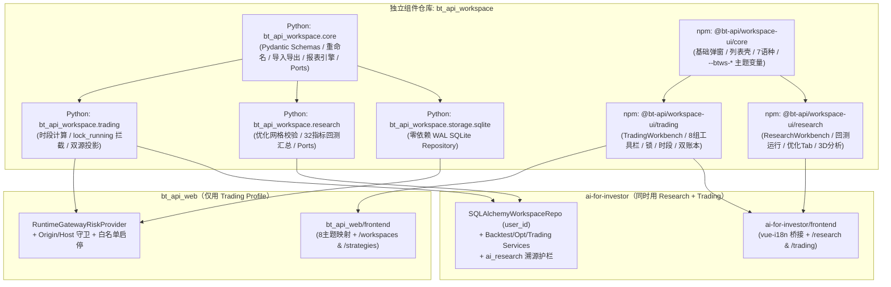

# 迭代 76：工作区独立组件（`bt_api_workspace`）拆分与双端集成开发计划

- **状态**：`REVIEW_PENDING`（G0 全部决策 `D76-01`～`D76-05` 采用方案 A；阶段一 `76.01`～`76.04`、阶段二 `76.05`～`76.06`、阶段三 `76.07`～`76.09` 均已完成实现与验证，详见[验收文档.md](./验收文档.md)，待用户最终验收）
- **G0 拍板口径（2026-11-28）**：
  - `D76-01`：方案 A — 新建独立单仓双包仓库 `D:\source_code\bt_api_workspace`（`python/` 产出 `bt_api_workspace`，`frontend/` 产出 `@bt-api/workspace-ui`）。
  - `D76-02` / `D76-03`：方案 A — Python 零重依赖内核（仅 Pydantic v2）按 `core / trading / research / storage.sqlite / fastapi` 分层；前端 `@bt-api/workspace-ui` 提供 `/core`、`/trading`、`/research` 三子路径导出，`bt_api_web` 打包 100% 剔除研究与参数优化模块。
  - `D76-04`：方案 A — 纯语义 CSS 变量（`--btws-*`）+ 两份宿主主题映射 + 内置 7 语种词典并支持外部 `vue-i18n` 桥接。
  - `D76-05`：方案 A — 三阶段推进：独立建成并自测 `bt_api_workspace` → 先切 `bt_api_web`（仅 `trading`）并 SimNow 实盘复验 → 再切 `ai-for-investor`（`trading + research` 双接入）。
- **创建日期**：2026-11-28
- **前置基线**：
  - 迭代 75（[迭代计划.md](../迭代75-bt_api_web交易工作区策略单元与组合总览增强/迭代计划.md) / [验收文档.md](../迭代75-bt_api_web交易工作区策略单元与组合总览增强/验收文档.md)）：`bt_api_web` 已完成交易工作区、策略单元 8 组 24 按钮工作台、双账本持仓隔离、交易日统计、自动交易时段计划、单元锁控与组合总览增强（`bt_api_web@862f755`，SimNow `review10` 11/11 策略实盘验收通过）。
  - `ai-for-investor`：已具备成熟的 **研究工作区（`research`）**（回测串/并行编排、参数网格/随机优化、1D/2D/3D 参数分析、32 项指标组合报告、工作区级多数据源配置）与 **实盘/模拟交易工作区（`trading`）**（21 按钮交易工具栏、锁控、自动交易时段、持仓管理、交易日统计、运行日志与状态快照）。
- **核心目标**：将「工作区（Workspace）」能力从两个宿主项目中解耦，拆分为独立可复用的组件仓库 **`bt_api_workspace`**（单仓双包：Python `bt_api_workspace` + 前端 `@bt-api/workspace-ui`），并原生内置 **`core`（公共内核） + `research`（研究工作区） + `trading`（实盘交易工作区）** 三层模块化设计：
  - **`ai-for-investor`**：同时集成 **`research` + `trading`** 两套工作区。
  - **`bt_api_web`**：**仅集成 `trading`** 实盘工作区（构建产物与 Python 依赖零回测、零参数优化、零 SQLAlchemy 污染）。
- **涉及仓库**：
  - `D:\source_code\bt_api_workspace`（**新建独立仓库**，承载 Python 包与前端组件库）
  - `D:\source_code\bt_api_web`（一期率先接入 `trading` 能力，验证零回归与 SimNow 实盘闭环）
  - `D:\source_code\ai-for-investor`（二期平滑接入 `research` + `trading` 能力，替换重复工作区代码，保留多用户 ORM/回测/优化/AI 投研溯源护栏）
  - `D:\source_code\backtrader`（仅归档本迭代计划与验收文档；**核心引擎与 `bt_api_py` SDK 绝不反向依赖 `bt_api_workspace`**）
- **铁律约束**：本地 `dev` 分支小步提交，**严禁 `git push`**；不破坏既有 REST API 路径与数据库数据（提供无损迁移）；严守 `bt_api_web` 安全红线（零私钥/宿主路径暴露、零打开本地目录、双账本隔离、Fail-Closed 绝不补零）。

---

## 1. 背景、动机与两类工作区差异全景分析

### 1.1 为什么必须拆分？

迭代 75 完成后，`ai-for-investor` 与 `bt_api_web` 中已经同时存在两套高度相似的工作区后端模型与前端弹窗组件：
- **高度同构的共同基础**：两者的前端技术栈甚至精确到相同小版本（`vue 3.5.42`、`element-plus 2.14.5`、`@element-plus/icons-vue 2.3.1`、`pinia 2.x`、`echarts 6.1.0`、`vite 6.0.5`）；后端均使用 `FastAPI + Pydantic v2`，共享锁控、自动交易时段与缓冲计算、单元/分组智能重命名、排序、单元参考交易参数、数据源参考配置、跨工作区与 JSON/CSV 导入导出、分组联动、可定制报表列等完整领域规则。
- **高耦合痛点**：当前每次新增按钮、修复表单校验、补齐多语言或改进报表交互，都需要手工在两个仓库间来回搬运代码，长期演进必然产生行为漂移与重复维护成本。

### 1.2 为什么不能拆成“大一统单块包”？（差异点核对）

经逐文件核对，两个宿主及两类工作区存在**不可抹平的本质差异**，架构设计必须用 **Profile（场景包） + Port（端口接口） + Capability（能力开关）** 清晰隔离：

| 对比维度 | 公共内核（`core`） | 研究工作区（`research`） | 实盘交易工作区（`trading`） |
| :--- | :--- | :--- | :--- |
| **使用方** | `bt_api_web` + `ai-for-investor` | **仅 `ai-for-investor`**（及未来投研宿主） | **`bt_api_web` + `ai-for-investor`** |
| **核心隐喻** | 工作区容器、策略单元编排、分组、排序、重命名、导入导出、参考配置、报表框架 | 历史回测实验台：策略模板实例化、串/并行批量回测、参数优化网格/3D 分析、多策略回测权重组合报告 | 实时交易运维台：运行态监控、锁交易/锁运行防误操作、自动交易时段计划、双账本/实时持仓、交易日统计、受控日志与受控启停 |
| **工作区来源与多租户** | 抽象 `WorkspaceRepositoryPort`（按 `owner_id` 可选隔离） | 多用户 DB 自由建删（`user_id` 外键，SQLAlchemy/PostgreSQL/MySQL/SQLite） | `bt_api_web` 为双源投影（`default` Runtime 自动托管 + `config.yaml` 声明 + 本地 SQLite `custom`）；`ai-for-investor` 为多用户 DB 自由建删 |
| **工作区级数据源** | 单元级 `data_config` | **独有**：工作区级 `WorkspaceDataSourceDialog`（CSV 目录 / MySQL / PostgreSQL / MongoDB） | 无工作区级离线库配置；以 Runtime 脱敏 Feed 元数据（品种/交易所/周期/合约规格）为主 |
| **单元运行操作** | 统一 `UnitExecutionPort` 抽象 | 串行运行、并行运行、停止回测、重载策略、切换标的（`ChangeSymbolDialog`）、新建策略单元（`CreateUnitDialog`）、查看回测报告 | 锁定交易、锁定运行（**后端 Fail-Closed 拒停**）、受控启动/优雅停止（`bt_api_web` 须 `admin` + 白名单 + UUID `command_id` + `reason`，禁止 force kill） |
| **参数优化能力** | 无（绝不污染 `core` 与 `trading`） | **独有**：单单元优化配置、批量优化配置、线程配置、批量提交、复制优化参数、优化结果 Tab（表格 + 1D/2D/3D 参数分析 + 应用最优参数）、定时优化 | `bt_api_web` **明确禁用**；`ai-for-investor` 交易工作区可通过 `capabilities.optimization = true` 按需挂载优化入口 slot |
| **持仓/日志/图表** | 统一弹窗壳与状态契约 | 回测指标快照、K 线回测结果跳转 | 持仓管理器（`bt_api_web` 严格双账本隔离）、交易日统计、安全白名单日志查看器（零宿主路径/零私钥）、观测执行走势图 |
| **安全与溯源护栏** | 统一输入净化、有界大小校验、Fail-Closed 缺失规则 | `ai-for-investor` 独有 `settings.ai_research` 服务端溯源写保护与已认证模拟盘防篡改（通过 `PolicyGuardPort` 注入） | `bt_api_web` 独有 loopback Host/Origin 中间件、零物理路径/零 `state/keys/*.secret`、禁止打开本地目录 |

---

## 2. G0 架构决策门禁（需用户拍板后开工）

| 决策 ID | 议题 | 选项 A（推荐） | 选项 B |
| :--- | :--- | :--- | :--- |
| **`D76-01`** | **独立仓库定位与结构** | 新建独立仓库 `D:\source_code\bt_api_workspace`（与 `bt_api_web` 同级），单仓双包：`python/`（PyPI 包 `bt_api_workspace`）+ `frontend/`（npm 包 `@bt-api/workspace-ui`），不作为 `bt_api_py` 核心子模块 | 拆分为两个完全独立的 Git 仓库（`bt_api_workspace_py` 与 `bt_api_workspace_ui`），版本联动成本更高 |
| **`D76-02`** | **Python 包分层与依赖策略** | 零重依赖内核（仅依赖 `pydantic>=2.10`）；按子包划分 `core` / `trading` / `research` / `storage.sqlite`（标准库 `sqlite3`）；可选 extra：`[fastapi]`、`[sqlalchemy]`（仅 `ai-for-investor` 需要时选装） | 将 SQLAlchemy 2.0 写入基础依赖（会显著增加 `bt_api_web` 依赖面与审计成本） |
| **`D76-03`** | **前端组件库导出与按需打包策略** | `@bt-api/workspace-ui` 提供 3 个独立子路径导出：`@bt-api/workspace-ui/core`、`@bt-api/workspace-ui/trading`、`@bt-api/workspace-ui/research`。`bt_api_web` 仅导入 `/core` + `/trading`，Vite 打包 100% Tree-Shaking 剔除研究/优化/3D 图表代码 | 单一顶层全量导出（容易把 `research` / `echarts-gl` 依赖泄漏进 `bt_api_web` 打包产物） |
| **`D76-04`** | **前端样式与 i18n 解耦方案** | 组件库内部使用纯语义 CSS 变量（`--btws-*`），同时提供两份极薄主题映射表（一份对接 `bt_api_web` 8 套主题变量，一份对接 `ai-for-investor` `--bg-color/--border-color` 变量），零 Tailwind 强依赖；内置 7 语言默认词典并支持宿主注入 `t(key, params)` 桥接 `vue-i18n` | 在组件库内绑定 Tailwind CSS 与 `vue-i18n`（会导致 `bt_api_web` 被迫引入 Tailwind 与双套 i18n） |
| **`D76-05`** | **双端分阶段迁移顺序** | **三阶段绞杀迁移（推荐）**：① 独立建成并自测 `bt_api_workspace`（Python + Vue 双端契约/单测全绿）→ ② 先切换 `bt_api_web`（仅 `trading`）并跑通全量 417+186+8 测试及 SimNow 实盘 → ③ 再平滑切换 `ai-for-investor`（先 `trading` 后 `research`）并跑通其既有全量测试 | 同步一次性改造三个仓库（排错半径大、回滚复杂） |

---

## 3. `bt_api_workspace` 目标架构设计

### 3.1 仓库与包目录总览

```text
D:\source_code\bt_api_workspace/
├── README.md
├── pyproject.toml                       # Python 包构建配置 (bt_api_workspace)
├── python/
│   ├── src/bt_api_workspace/
│   │   ├── __init__.py
│   │   ├── core/                        # 【公共内核 — 仅依赖 Pydantic v2 + 标准库】
│   │   │   ├── models.py                # WorkspaceType('research'|'trading'), WorkspaceSourceKind, WorkspaceCapabilities,
│   │   │   │                            # WorkspaceBase, StrategyUnitBase, UnitSettingsConfig, UnitDataConfig,
│   │   │   │                            # RenameRequest, ReorderRequest, TransferRequest, ReportConfig
│   │   │   ├── rules.py                 # 智能重命名引擎(6模式)、输入净化、JSON/CSV 导入导出编解码、配置 workspace 声明解析
│   │   │   ├── report_engine.py         # 通用分组汇总、自定义列过滤、精确 Decimal 统计（Fail-Closed None）
│   │   │   └── ports.py                 # WorkspaceRepositoryPort / UnitProviderPort / PolicyGuardPort / AuditSinkPort
│   │   ├── trading/                     # 【实盘交易 Profile — bt_api_web & ai-for-investor 共用】
│   │   │   ├── models.py                # AutoTradingSession/Config/ScheduleItem, UnitLocks, TradingUnitView,
│   │   │   │                            # DualLedgerPositionsView, DailyStatsView, ControlCommandItem/Result, ReadinessItem
│   │   │   ├── schedule.py              # 自动交易开收盘缓冲计算（含跨零点夜盘回绕）、当日计划表生成
│   │   │   ├── guards.py                # lock_running Fail-Closed 控制拦截、允许列表与安全边界断言
│   │   │   └── projector.py             # 双源工作区投影器（default + config.yaml + custom 合并排序）
│   │   ├── research/                    # 【研究回测 Profile — 仅 ai-for-investor 使用】
│   │   │   ├── models.py                # WorkspaceDataSourceConfig(csv/mysql/pg/mongo), ParamRangeSpec,
│   │   │   │                            # OptimizationRequest/Progress/ResultRow/Artifact, ResearchUnitView,
│   │   │   │                            # ResearchReportRequest/Summary/UnitRow(32+绩效字段)
│   │   │   ├── optimization_rules.py    # 参数网格组合数校验、排序/tie-break 规范、参数范围复制逻辑
│   │   │   ├── report_rules.py          # 简单/复利年化、等权/自定义权重汇总、最优/最差单元提取
│   │   │   └── ports.py                 # BacktestRunnerPort / OptimizationRunnerPort / ResearchArtifactPort
│   │   ├── storage/
│   │   │   ├── sqlite.py                # 零依赖 WAL SQLite Repository（v2 schema，含 v1→v2 无损升级，bt_api_web 开箱即用）
│   │   │   └── memory.py                # 内存 Repository（供单测与 demo 模式直接复用）
│   │   └── fastapi/                     # 【可选 extra: bt_api_workspace[fastapi]】
│   │       ├── trading_router.py        # create_trading_workspace_router(repo, provider, auth, guard, capabilities)
│   │       └── research_router.py       # create_research_workspace_router(repo, runner, opt_runner, auth, guard)
│   └── tests/
│       ├── test_core_rules.py
│       ├── test_trading_schedule_and_guards.py
│       ├── test_research_optimization_and_report.py
│       ├── test_sqlite_repository.py
│       └── test_fastapi_routers.py
└── frontend/                            # npm 包: @bt-api/workspace-ui
    ├── package.json                     # peerDependencies: vue, element-plus, @element-plus/icons-vue, echarts
    ├── tsconfig.json
    ├── vite.config.ts                   # 多入口 Library 模式构建: core / trading / research / styles
    ├── src/
    │   ├── core/                        # 【@bt-api/workspace-ui/core】
    │   │   ├── types.ts                 # 与 Python contracts 1:1 对齐的 TS 类型
    │   │   ├── capabilities.ts          # WorkspaceCapabilities 接口 + TRADING_OPS_PRESET / TRADING_FULL_PRESET / RESEARCH_PRESET
    │   │   ├── adapter.ts               # WorkspaceCoreAdapter / TradingWorkspaceAdapter / ResearchWorkspaceAdapter 接口
    │   │   ├── i18n/                    # 7 语种内置词典 + createWorkspaceI18n / useWorkspaceT（支持注入 vue-i18n）
    │   │   ├── styles/                  # tokens.css（--btws-* 语义变量）+ adapter-bt-api-web.css + adapter-ai-investor.css
    │   │   └── components/              # 跨研究/实盘完全共用的基础组件：
    │   │       ├── WorkspaceListShell.vue         # 卡片/表格切换、Hero 指标、搜索/过滤、批量操作、新建/编辑弹窗
    │   │       ├── WorkspaceCard.vue              # 工作区卡片（支持研究/实盘徽章与插槽）
    │   │       ├── CreateWorkspaceDialog.vue      # 新建/编辑工作区
    │   │       ├── DataSourceDialog.vue           # 单元级数据源/Feed 配置（支持只读实盘模式 & 可编辑研究模式）
    │   │       ├── UnitSettingsDialog.vue         # 单元资金/保证金/手续费/滑点配置
    │   │       ├── StrategyParamsDialog.vue       # 策略参数（支持实盘脱敏只读+备注 / 研究可编辑模式）
    │   │       ├── UnitRenameDialog.vue           # 单元重命名（6 模式）
    │   │       ├── GroupRenameDialog.vue          # 批量分组重命名（6 模式）
    │   │       ├── GroupLinkDialog.vue            # 分组联动
    │   │       ├── ImportUnitsDialog.vue          # 跨工作区 / JSON 导入
    │   │       ├── ExportUnitsDialog.vue          # 跨工作区 / JSON / CSV 导出
    │   │       └── WorkspaceReportShell.vue       # 可定制列、作用域筛选、ECharts 对比图、报告导出（支持研究 32 指标扩展）
    │   ├── trading/                     # 【@bt-api/workspace-ui/trading】
    │   │   ├── index.ts
    │   │   └── components/
    │   │       ├── TradingWorkspaceWorkbench.vue  # 实盘工作区完整装配（4 KPI + 3 项时段条 + 就绪检查 + 多 Tab）
    │   │       ├── TradingUnitActionsBar.vue      # 8 组实盘工具栏（按 capabilities 启停/锁控/优化 slot 显隐）
    │   │       ├── TradingUnitTable.vue           # 实盘单元表（可配列、双击详情、双账本归因列/交易快照列）
    │   │       ├── UnitRunStatusBadge.vue         # 运行状态点 + 模式 + 置顶 + 锁交易/锁运行徽章
    │   │       ├── AutoTradingConfigDialog.vue    # 自动交易时段配置与当日时间表预览
    │   │       ├── TradingUnitDetailDialog.vue    # 单元详情（脱敏参数、合约规格、归因持仓、成交流水、控制原因）
    │   │       ├── UnitRuntimeLogsDialog.vue      # 安全白名单有界日志查看器（禁止宿主路径与打开目录）
    │   │       ├── PositionManagerDialog.vue      # 持仓管理器（支持双账本严格隔离视图 & 交易汇总视图）
    │   │       ├── TradingDayStatsDialog.vue      # 交易日统计
    │   │       ├── UnitMarketChartDialog.vue      # 观测执行走势图（Fail-Closed 空态）
    │   │       └── GatedControlConfirmDialog.vue  # 二次确认 + 必填原因 + UUID command_id + UNKNOWN 提示
    │   └── research/                    # 【@bt-api/workspace-ui/research】
    │       ├── index.ts
    │       └── components/
    │           ├── ResearchWorkspaceWorkbench.vue # 研究工作区完整装配（数据源入口 + Units/Optimization/Report 可关闭 Tab）
    │           ├── ResearchUnitActionsBar.vue     # 串/并行运行、停止、重载、建删导入导出、换标的、优化组、重命名、排序
    │           ├── ResearchUnitTable.vue          # 回测单元表（进度条、优化进度、结果摘要、耗时/剩余、Bar 数）
    │           ├── WorkspaceDataSourceDialog.vue  # 工作区级数据源（CSV/MySQL/PostgreSQL/MongoDB）
    │           ├── CreateUnitDialog.vue           # 从策略模板批量新建策略单元
    │           ├── ChangeSymbolDialog.vue         # 单/批量切换标的与周期
    │           ├── OptimizationConfigDialog.vue   # 单单元参数范围与目标配置
    │           ├── BatchOptimizationConfigDialog.vue # 批量参数优化配置
    │           ├── OptimizationThreadDialog.vue   # 并行线程/超时配置
    │           ├── ScheduledOptimizationDialog.vue # 定时优化计划配置
    │           └── WorkspaceOptimizationTab.vue   # 优化结果表 + 1D/2D/3D 参数分析 + 应用最优参数 + 导出
    └── tests/                           # Vitest 组件单测 + 契约与 7 语种零中文泄漏测试
```

### 3.2 能力开关（`WorkspaceCapabilities`）双端配置矩阵

通过统一的 `WorkspaceCapabilities` 契约，彻底消除组件内的宿主硬编码判断：

| Capability 开关 | `bt_api_web` (`trading`) | `ai-for-investor` (`trading`) | `ai-for-investor` (`research`) |
| :--- | :---: | :---: | :---: |
| `workspaceType` | `'trading'` | `'trading'` | `'research'` |
| `membershipMode` | `'projected_and_custom'`（默认托管 + `config.yaml` + 自定义） | `'user_managed'`（自由增删单元） | `'user_managed'`（自由增删单元） |
| `supportsCreateUnitFromTemplate` | `false`（改用“编排/新建自定义工作区”） | `true` | `true` |
| `supportsAutoTradingSchedule` | `true`（仅运维时段计划） | `true`（接 APScheduler） | `false` |
| `supportsUnitLocks` | `true`（`lock_running` 后端强拒停） | `true` | `false` |
| `supportsGatedRuntimeControl` | 按服务端白名单 + `admin` 动态返回 | `true`（走交易实例启停） | `false` |
| `supportsBacktestExecution` | `false` | `false` | `true`（串行/并行/停止/重载） |
| `supportsOptimization` | `false`（Tree-Shaking 零引入） | `true`（经 slot/配置启用） | `true`（全量优化面板 + Tab） |
| `supportsDualLedgerPositions` | `true`（策略归因 ≠ 柜台权威严格隔离） | `false`（展示交易快照汇总） | `false` |
| `supportsWorkspaceDataSource` | `false` | `false` | `true`（CSV/MySQL/PG/Mongo） |
| `paramsEditable` | `false`（脱敏只读 + 运维备注） | `true` | `true` |
| `allowOpenHostDirectory` | **`false`（永久禁止安全红线）** | 按宿主既有策略控制 | `false` |

### 3.3 双端集成架构图



---

## 4. 分阶段实施路线图（`76.01`～`76.09`）

### 阶段一：独立建成 `bt_api_workspace` 核心包与前端组件库（不触碰任何宿主）

- **`76.01` 仓库初始化与 Python `core` + `storage.sqlite` 内核**
  - 初始化 `D:\source_code\bt_api_workspace`（`dev` 分支），建立 `pyproject.toml`（仅依赖 `pydantic>=2.10`，可选 `[fastapi]`、`[dev]`）。
  - 落地 `bt_api_workspace.core`（通用模型、6 模式重命名引擎、JSON/CSV 编解码、分组报表引擎、`WorkspaceRepositoryPort`/`PolicyGuardPort`）。
  - 迁移并泛化 `bt_api_web/workspace_store.py` 至 `bt_api_workspace.storage.sqlite`（**100% 兼容既有 `workspaces.sqlite3` v1/v2 表结构与 `portfolio_equity_samples` 隔离表边界**；注意：`portfolio_equity_samples` 属于组合总览，留在 `bt_api_web` 自己的存储或独立表，不混入通用工作区内核！）。
  - 交付证据：`pytest` 单元测试全绿 + `mypy` 严格通过 + 零外部重依赖审计。

- **`76.02` Python `trading` Profile 与可选 `fastapi` 路由工厂**
  - 落地 `bt_api_workspace.trading`：自动交易时段/缓冲计算（含跨日夜盘回绕）、`lock_running` Fail-Closed 拦截器、双源工作区投影器（`default` + `config` + `custom`）、双账本持仓与交易日统计 DTO。
  - 落地 `bt_api_workspace.fastapi.trading_router`：接收注入的 `repo`、`provider`、`auth`、`control_gate`、`policy_guard`，输出标准有界路由（含 JSON 重复键/NaN 拒绝与 128 KiB 载荷上限）。
  - 交付证据：`UNIT/FAKE` 覆盖全部路由、权限、锁拒停、时段边界与 SQLite 升级回归。

- **`76.03` Python `research` Profile（面向 `ai-for-investor`）**
  - 落地 `bt_api_workspace.research`：多数据源配置 Schema（`csv/mysql/postgresql/mongodb`）、参数优化范围/组合数/排序/tie-break 规则、32+ 项回测绩效汇总与加权报告规则、`BacktestRunnerPort` / `OptimizationRunnerPort` 协议、以及可插拔 `PolicyGuardPort`（允许 `ai-for-investor` 无缝接入 `ai_research` 服务端溯源写保护）。
  - 交付证据：`UNIT` 测试覆盖网格组合计算、简单/复利与权重计算、数据源验证与护栏拒绝。

- **`76.04` 前端组件库 `@bt-api/workspace-ui`（`core` + `trading` + `research` 三入口）**
  - 建立 `frontend/` Vite Library 模式工程，配置 `package.json` `exports`（`./core`、`./trading`、`./research`、`./styles/*`），`peerDependencies` 声明 `vue`、`element-plus`、`@element-plus/icons-vue`、`echarts`（`echarts-gl` 设为 `optional` 仅 `research` 3D 分析按需动态导入）。
  - 实现纯语义 CSS 变量 `--btws-*` + 两份主题映射文件（`adapter-bt-api-web.css` / `adapter-ai-investor.css`），确保深浅色 8 套主题与 `ai-for-investor` 主题均零样式冲突。
  - 实现 7 语种内置词典 + `WorkspaceI18nBridge`（支持 `ai-for-investor` 透传 `vue-i18n` `t()`，支持 `bt_api_web` 直接切换 7 语言且零中文泄漏）。
  - 完成 `core`（11 个通用组件）、`trading`（11 个实盘组件）、`research`（11 个研究/优化组件）实现与独立 Vitest 组件测试。
  - **关键门禁**：验证仅导入 `@bt-api/workspace-ui/trading` 的最小测试应用打包产物中**完全不含** `research` / `Optimization` / `echarts-gl` 代码。

### 阶段二：`bt_api_web` 率先切换接入（仅 `trading` Profile）

- **`76.05` `bt_api_web` 后端切换至 `bt_api_workspace`（`trading` + `storage.sqlite`）**
  - 在 `bt_api_web` 中通过依赖引入 `bt_api_workspace`（开发期 `pip install -e`），保留 `bt_api_web` 专属的：
    - `RuntimeGatewayRiskProvider`（对接 `bt_api_runtime` / `bt_api_gateway` / `bt_api_risk` 只读聚合与缓存）
    - `WorkspaceRuntimeControl`（白名单优雅启停）
    - `app.py` 回环 `Host/Origin` 安全中间件与 `portfolio_equity_samples` 采样表。
  - 保持 `/api/v1/workspaces/*` **100% URL、状态码与响应结构向后兼容**；原 `workspace_models.py` / `workspace_store.py` / `workspace_routes.py` 瘦身为薄适配层与兼容导出。
  - 交付证据：`bt_api_web` 既有 **417+ 后端 pytest 零修改全通过**（含 `v1 -> v2` 迁移与 `unit_locked_running` 拦截测试）。

- **`76.06` `bt_api_web` 前端切换至 `@bt-api/workspace-ui/trading` + SimNow 实盘复验**
  - `bt_api_web/frontend` 仅依赖 `@bt-api/workspace-ui/core` 与 `@bt-api/workspace-ui/trading`，注入 `btApiWebTradingAdapter` 与 `TRADING_OPS_PRESET` 能力开关；删除 `frontend/src/components/workspace/` 下的重复实现，仅保留极薄路由壳页与业务适配器。
  - 交付证据：
    - `vue-tsc --noEmit` 0 errors；Vitest **186+ 用例全绿**；Vite 构建产物体积验证（不含任何 `research`/`optimization` chunk）；Playwright E2E **8/8 全绿**。
    - 重启 SimNow 7x24 全栈（`review11`），5/5 组件 + 11/11 策略浏览器实测全套工作区按钮、锁控、时段计划、弹窗、8 主题与 EN 零中文泄漏。

### 阶段三：`ai-for-investor` 平滑切换接入（`trading` + `research` 双 Profile）

- **`76.07` `ai-for-investor` 后端适配接入 `bt_api_workspace`（`core` + `trading` + `research`）**
  - 不改 PostgreSQL/MySQL/SQLite 既有 Alembic 表结构！编写薄适配器：
    - `SqlAlchemyWorkspaceRepository`（实现 `WorkspaceRepositoryPort`，保留 `user_id` 租户隔离）
    - `AIResearchProvenanceGuard`（实现 `PolicyGuardPort`，100% 保留 `_reject_server_owned_ai_research_settings` 与已认证模拟盘不可篡改规则）
  - 将 `ai-for-investor` 中重复的时段缓冲计算、6 模式重命名、单元设置规范化、参数优化范围校验与报告汇总规则委托给 `bt_api_workspace` 领域模块；保留 `BacktestService`、`OptimizationExecutionManager`、`TradingWorkspaceService`、`APScheduler` 自身调度职责。
  - 交付证据：`ai-for-investor` 既有全部 `test_workspace*.py` / `test_trading_workspace*.py` / `test_ctp_certification_workspaces.py` 后端 pytest 全绿。

- **`76.08` `ai-for-investor` 前端渐进切换至 `@bt-api/workspace-ui`（先 `trading` 后 `research`）**
  - 实现 `aiInvestorTradingAdapter` + `aiInvestorResearchAdapter`（对接现有 `workspaceApi` 与 `useWorkspaceStore`）及 `vue-i18n` 桥接。
  - **子步 A（Trading Workspace）**：`TradingWorkspaceUnitsTab` 切换为 `@bt-api/workspace-ui/trading` 的 `TradingWorkspaceWorkbench`（通过 `capabilities.optimization = true` 与具名 slot 挂载其特有的“新建优化任务 / 优化结果 / 定时优化”按钮）。
  - **子步 B（Research Workspace）**：`WorkspaceUnitsTab`、`WorkspaceOptimizationTab`、`WorkspaceReportTab` 及公共弹窗切换为 `@bt-api/workspace-ui/research` 与 `@bt-api/workspace-ui/core`。
  - 交付证据：`ai-for-investor/src/frontend` 的 `npm run typecheck`、`npm run lint`（`--max-warnings 0`）、Vitest（全部 `workspace` 组件与页面单测）、Playwright E2E 全绿。

- **`76.09` 跨项目契约回归、打包发布检验与验收归档**
  - 验证三仓隔离安装（wheel + npm tarball 离线打包安装无缺失文件、无循环依赖）。
  - 验证 `bt_api_web` 与 `ai-for-investor` 在各自工作区上的功能一致性与边界隔离性。
  - 输出迭代 76 验收文档，记录各仓库本地 `dev` commit、分层证据矩阵（`UNIT/FAKE`、`PACKAGE_BUILD`、`FRONTEND_UNIT/E2E`、`SIMNOW`、`AI_FOR_INVESTOR_REGRESSION`），待用户最终验收。

---

## 5. 风险识别与回滚边界

| 风险项 | 影响 | 缓解与回滚策略 |
| :--- | :--- | :--- |
| **前端依赖版本/Element Plus 样式冲突** | 两个宿主主题体系不同（Tailwind vs 纯 CSS 变量）可能导致弹窗间距或暗色主题对比度异常 | 组件库内部 **100% 使用 `--btws-*` 语义变量**，不写任何 Tailwind class；通过两份独立 CSS token 映射表对接两套宿主，并用 Playwright 在亮/暗色主题下截图对比验证 |
| **回测/优化重依赖泄漏到 `bt_api_web`** | 破坏 `bt_api_web` 极简运维台定位与安全边界 | Python 侧通过独立子包 + optional extras 隔离，CI/单测显式断言 `bt_api_web` 环境中不导入 `sqlalchemy`/`research`；前端通过 `package.json` `exports` 子路径 + Vite 打包产物扫描断言零 `research`/`echarts-gl` 残留 |
| **`ai-for-investor` 既有认证/AI 投研护栏回退** | `ai_research` 服务端溯源字段被客户端覆盖或破坏已有认证测试 | 将 `PolicyGuardPort` 设为显式注入钩子，`ai-for-investor` 保留既有护栏代码与 `verify:approval-errors` 校验脚本，原样纳入回归门禁 |
| **多仓本地联调摩擦** | 改完组件库后宿主看不到最新变更 | 开发期 Python 使用 `pip install -e D:\source_code\bt_api_workspace`、前端使用本地 npm `file:` 依赖 + `vite` watch/build 脚本；阶段二与阶段三独立提交，任一宿主均可在单 commit 粒度独立回滚 |

---

## 6. 验收通过标准（Definition of Done）

1. **`bt_api_workspace` 独立自洽**：Python 包可独立 `python -m build` 产出 wheel，前端可独立 `npm run build` 产出 `core`/`trading`/`research` 三子路径包，自身单测与类型检查全绿。
2. **`bt_api_web` 零退化 + 零研究依赖污染**：完整切换至 `bt_api_workspace`（仅 `trading`），后端 417+ pytest、前端 186+ Vitest、Playwright 8/8 E2E、SimNow 7x24 5 组件 + 11 策略浏览器实测全通过，打包产物不含任何 `research`/`optimization` 模块。
3. **`ai-for-investor` 双工作区无损切换**：`research` 与 `trading` 两个工作区均成功接入 `bt_api_workspace`，原有回测、网格优化、3D 参数分析、32 项指标组合报告、定时任务与 `ai_research` 护栏全部正常，既有后端 pytest + 前端 typecheck/lint/Vitest/E2E 全通过。
4. **核心 SDK 边界零污染**：`backtrader` 与 `bt_api_py`（含 `runtime/gateway/risk/execution/monitor`）对 `bt_api_workspace` 保持 **零依赖**。
5. **严守仓库与推送纪律**：全部提交仅保留在各自本地 `dev` 分支，绝不执行 `git push`。
