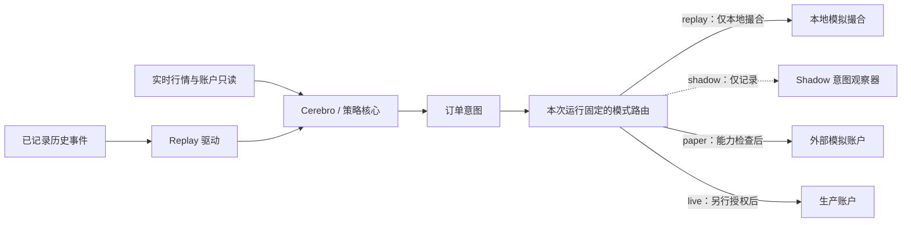

# 交易运行模式

本文定义系统目标中的四种**交易运行模式**。它们是数据来源、账户环境和可用能力的边界，
不是 `Cerebro.runonce` / `runnext` 这样的计算调度选项，也不是
`Cerebro.replaydata()` 的时间周期转换功能。本文是架构语义说明，不表示相应模式已经实现或通过账户验收。

## 模式定义

| 模式 | 数据与账户 | 允许的写操作 | 目标归属 |
|---|---|---|---|
| **replay（历史回放）** | 从已记录的历史市场事件按历史时钟驱动策略；成交状态由本地模拟器产生 | 仅本地模拟撮合，不调用外部交易接口 | 历史事件读取、时钟推进和本地模拟执行 |
| **shadow（影子）** | 读取实时行情；可选读取指定账户的状态用于比较 | **不允许**提交、撤销、改单等外部写命令 | 实时只读输入与策略意图观察/审计 |
| **paper（外部模拟账户）** | 连接经纪商或交易所提供的模拟账户、测试网及其专用 endpoint | 仅向明确绑定的模拟环境发送获准的写命令 | 共享交易核心加隔离的外部模拟账户配置 |
| **live（生产账户）** | 连接明确绑定的生产 endpoint 和真实账户 | 只有独立、明确授权后才可发送生产写命令 | 共享交易核心加生产环境能力与授权边界 |

这里的 **paper 专指外部模拟账户**。`BackBroker`、本地撮合器、fake provider 和离线回测都属于
**本地模拟/回测**，不能据此称为 paper，也不能据此声称外部模拟账户验收通过。

`shadow` 可计算“若允许交易，本次会产生什么意图”，但只能记录或比较意图；订单意图不得流入
任何能提交、撤销或修改外部订单的入口。只读账户数据也不改变这一限制。

## 同一策略跨模式复用

长期架构目标是：同一份适用的 `bt.Strategy` 代码在普通回测和上述四种交易模式之间不需要修改；
运行入口通过配置选择对应的 Feed、Broker、Store 及装配。策略以框架公共接口消费行情、产生订单意图，
不在策略内判断环境、硬编码 provider API 或依赖某一种模式的私有对象。订单、成交、账户和数据时钟
的能力与差异必须由适配层明确表达；无法满足的策略能力要在装配或调用时明确拒绝，不能静默回退。

代码相同不意味着每种模式的成交、收益或事件时间完全相同。特别是 shadow 不得伪造成交：其订单意图
只用于观察，缺失的订单/持仓能力应明确报告。能否无修改运行取决于策略实际要求的能力和对应适配器的
支持；本页描述目标，不表示现有模式已全部实现或已通过跨模式验收。

## 共享核心链路与能力隔离

paper 与 live 复用同一套策略决策、订单意图、风险检查、订单状态归一化和结果通知链路；
环境差异由运行配置、能力检查和 broker/store 接入边界处理，不能散落在策略里，也不能靠
“换一个端口”隐式切换。

| 隔离项 | Paper 与 Live 的要求 |
|---|---|
| Endpoint 与账户 | 分别绑定模拟/生产 endpoint 和账户标识；启动时验证模式、endpoint 与账户相符，冲突时拒绝启动 |
| 凭据 | 分开引用和管理；模拟凭据不得被当作生产授权，生产凭据不得由 paper 配置隐式发现 |
| 权限 | 按能力显式授予，如行情读取、账户读取、提交、撤销和改单；未声明的写能力默认拒绝 |
| 交易差异 | 单独配置并校验合约、订单类型、数量单位、时段、限频、风控阈值与状态对账；不能假定测试环境与生产环境完全相同 |
| 启动与降级 | 模式在一次运行中显式固定；配置缺失或不一致时失败关闭，不从 live 自动降级到 paper，也不从 paper 升级到 live |

选择 `live` 只表达目标环境，**本身不授予真实交易权限**。生产写能力必须来自独立、明确且可核验的授权，
并绑定具体账户和能力范围；普通配置存在、生产 endpoint 可达或持有凭据，都不能替代该授权。

## 迭代 52 范围与后续整合位置

迭代 52 **不实现、不调用，也不以本地测试或验收方式使用 replay、shadow 与旧本地模拟**。本节只记录未来整合边界：

- **Replay** 应归入历史数据/事件回放与本地模拟执行链路，复用 Cerebro 和策略计算；回放时钟、事件顺序、
  历史输入完整性及模拟成交规则由该链路负责，不经过生产 broker/store 写入口。
- **Shadow** 应归入实时只读数据与策略意图观察链路，在订单写入边界之前截取意图；其运行装配不得获得任何
  外部写能力。仓库现有只读服务代理可作为“读接口拒绝写入”的局部设计参考，但不等同于完整 shadow 模式。
- **Paper / Live** 应归入同一 broker/store 核心合同下的外部执行适配与服务运行时边界，并由互不混用的环境、
  账户、凭据和能力配置区分。现有可选服务执行会话和只读代理各有明确的窄范围，不能据此推断已有统一四模式路由。

本页也不声明 paper 或 live 已通过外部账户验收。有关现有构件的适用范围见
[可选服务执行会话](../../developer-guide/optional-service-execution-session.md)和
[可选服务读取代理](../../developer-guide/optional-service-read-proxy.md)。
